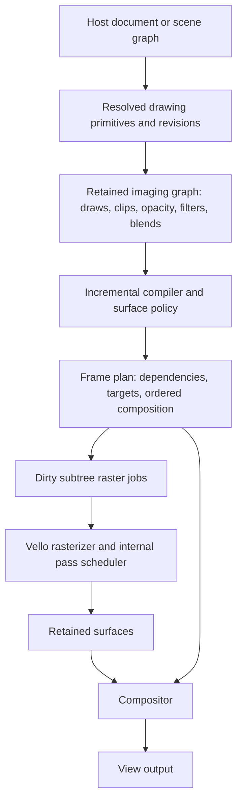

# A retained render-plan layer for Vello: Zulip research and an implementation proposal

> **Historical** (see [`plans/README.md`](../README.md)). Its adopted parts (contracts, constraints, acceptance tests) and its Decision block now live in [`rendering/architecture.md`](../rendering/architecture.md).

**Date:** 2026-10-14. **Status:** reference, partly adopted. Do not implement it as
written; the work order lives in [`handoff-render.md` §4](../handoff-render.md#4-what-to-do-in-order).

## Decision (2026-10-14 review)

- **No Vello fork.** Clean partitions skipping raster work, subtree-to-surface
  rendering and painter-ordered composition of surfaces all work with the public
  API (Iron already renders per-view textures, `Offscreen` views and
  `DrawCmd::Texture`). Only Stage D's multi-job single submission needs core
  changes. Upstream churn is high (`vello_gpu` wgpu backend: 29 commits in the
  three months to `db90a73`), and upstream is landing this kind of work itself
  (strip arena #1897, used-rows uploads #1896, target clears #1869). Propose
  per-job staging upstream if measurement ever needs it; otherwise use separate
  submissions, or on 0.3 one shared atlas target with `ClearSettings::Rects`.
- **The render plan is Iron-owned and backend-neutral** (vision 01 §2.4, the
  `iron_canvas_cache` boundary), not a crate shaped around Vello internals. It
  starts by extending the existing view-texture graph.
- **No new transform hierarchy.** §4's `set_placement(id, parent, …, transform)`
  is rejected. The graph takes resolved affines from the host, as `iron_spatial`
  does; parent edges express compositing containment only.
- **Adopted as stated:** §6 retention contracts, §7 correctness constraints and §9
  acceptance tests, including the A → B → C painter-order scene.
- **Deferred:** Stage D, and Stage D's prepared-job reuse (it conflicts with the
  memory concerns that removed `Recording`; discard a `Scene` once baked).
- **Order:** Iron's overlay target, per-subtree revisions and local/placement split
  come before chunks and baking. Iron currently has no opacity, blend or filter
  commands, so the first version covers source-over content and clips.

Read with [the retention audit](vello-retention-and-render-plan.md),
[the measured controls](../rendering/renderer-sanity-checks.md), and
[Iron's architectural vision](../vision/01_layered-architecture-overview.md).

## 1. Recommendation and feasibility

An agent can build a useful prototype of the architecture discussed on Zulip by
adding a retained render-plan layer and making targeted changes to Vello's frame
and resource interfaces. The first experiment should preserve the existing path
rasterizer, expose persistent subtree identities, render dirty subtrees into
surfaces, and composite those surfaces in the correct order.

This is more specific than adding a bitmap cache to Iron. The proposed layer
owns the reusable rendering representation, dependency invalidation, surface
lifetime and frame execution contract. Its client changes named rendering objects;
the layer decides what work Vello needs to do. It can live in an experimental
crate beside Vello and remain independent of Iron's document model and Bevy.

Start with that adaptation. A wholesale replacement of the sparse-strips kernel
is a separate research project, not necessary to establish whether retained
orchestration helps this editor. Likewise, restoring the removed strip-recording
API would not by itself provide the architecture described below.

The expected benefit is less repeated preparation for unchanged content. Success
must be demonstrated by work counters, image correctness and presentation traces.
This proposal does not promise a particular FPS improvement or make existing
performance measurements apply to newer Vello code.

## 2. What was actually said on Zulip

These are individual, dated design discussions, not an agreed specification or
evidence that a complete retained renderer has shipped. Dates below use Pacific
time. Public messages were read with the JavaScript spectator reader described
in §10.

| Discussion | Relevant argument | Source |
|---|---|---|
| Andrew's hierarchical compilation question; Raph, Jan 26, 2026 | A mostly retained document with minimal per-frame work is a use case for Understory | [Raph's reply](https://xi.zulipchat.com/#narrow/channel/197075/near/570195961) |
| Blit rect pipeline; Taj, Feb 15 | Image/text-heavy content can benefit from specialized drawing paths rather than all going through strip preparation | [Taj's experiment](https://xi.zulipchat.com/#narrow/channel/197075/near/574015451) |
| Blit rect pipeline; Bruce, Feb 15 | Separate scene graph, imaging graph and render plan; identify subtrees, surfaces, cached tiles and specialized paths | [Bruce's explanation](https://xi.zulipchat.com/#narrow/channel/197075/near/574033580) |
| Hybrid/Classic unification; Raph, Mar 11 | Higher-level orchestration could choose a pipeline for each sub-scene and retain textures for static content | [Raph's proposal](https://xi.zulipchat.com/#narrow/channel/197075/near/578760890) |
| Same discussion; Laurenz, Mar 12 | Uncached vector-heavy work is difficult for Hybrid because stroke expansion and flattening occur on the CPU | [Laurenz's observation](https://xi.zulipchat.com/#narrow/channel/197075/near/578874977) |
| Same discussion; Olivier, Mar 29 | Consider the imaging abstraction, while acknowledging that its scene recording was early and needed optimization | [Olivier's recommendation](https://xi.zulipchat.com/#narrow/channel/197075/near/582448832) |
| Removing recordings; Laurenz, Apr 22; Alex, Apr 30 | The old API constrained other development; removing it now did not rule out future caching | [Laurenz](https://xi.zulipchat.com/#narrow/channel/197075/near/590147396), [Alex](https://xi.zulipchat.com/#narrow/channel/197075/near/592180594), [merged PR](https://github.com/linebender/vello/pull/1611) |

Bruce's key formulation is that Vello CPU/Hybrid should be:

> “essentially sub-tree to surface renderers.”

The interpretation used in this proposal is: an orchestration layer selects a
bounded piece of imaging work and its target; Vello executes that work. Vello's
existing internal scheduler still manages the raster job's temporary layers and
passes. The outer plan controls which jobs persist across frames and when to
execute them. Those two scheduling levels have different responsibilities.

Bruce also explicitly distinguishes this from merely asking for a retained-mode
API. His emphasis is a useful imaging model and executable render plan. Stable
object identities are part of the client-facing proposal here, not a claim that
his message specifies an API of named editable objects.

## 3. Source versions inspected

| Source | Revision | Purpose |
|---|---|---|
| Iron's published `vello_hybrid 0.2.0` | `7073a85d61ee099d1d3595651ddf92302b074348` | Explain the current integration and benchmark |
| Current Vello source checkout | `db90a73ec7309dfa2bd45886b353162a9ea95744` | Identify current extension points and avoid proposing already implemented work |
| Understory used by Iron | `2ac7efbc010c8ee4daa316c34eadc0bafacfe83b` | Establish what the existing adapter supplies |

The upstream checkout is at `.agents/research/vello`. It is unmodified. The
current sparse-strips GPU crate is named `vello_gpu`; this snapshot declares
version 0.3.0 and uses wgpu 30. Features observed in this checkout are **source
snapshot facts**, not a claim that every feature is in the published 0.3.0 release.
Iron currently uses wgpu 29. A standalone prototype avoids forcing a Bevy upgrade
before the experiment produces useful evidence.
[Current package](https://github.com/linebender/vello/blob/db90a73ec7309dfa2bd45886b353162a9ea95744/vello_gpu/Cargo.toml),
[workspace dependencies](https://github.com/linebender/vello/blob/db90a73ec7309dfa2bd45886b353162a9ea95744/Cargo.toml#L153).

The snapshot still records paths into device-space strips and resets recorded
data in `Scene::reset`. It is not already the persistent object/update interface
proposed here.
[Scene recording](https://github.com/linebender/vello/blob/db90a73ec7309dfa2bd45886b353162a9ea95744/vello_gpu/src/scene.rs#L358),
[reset](https://github.com/linebender/vello/blob/db90a73ec7309dfa2bd45886b353162a9ea95744/vello_gpu/src/scene.rs#L902).

## 4. Architecture to prototype



**The host document** owns author intent, bindings, constraints and editing.
Iron's `NodeId` stays here; it does not become an upstream Vello dependency.

**The imaging graph** describes rendering semantics: local geometry, brushes,
ordered children, clipping, group opacity, filters, blend behavior and source
resources. It has stable rendering ids and explicit content dependencies.

**The compiler** preserves unchanged prepared artifacts and chooses partitions.
A partition can be an authored group, a contiguous painter-order run, or an
isolated effect subtree. It is not necessarily one authored node or one view.

**The frame plan** identifies dirty raster jobs, required surfaces and the order
of composition. Cached output is a first-class input. A child texture changing
can dirty an ancestor's pixels without requiring its unchanged local geometry
to be rebuilt.

**The backend** executes jobs into caller-owned targets. Initial representation
choices are live vector content and retained RGBA surfaces. Later experiments
can add prepared vector artifacts, direct image/glyph paths or compute rendering.
Switching those strategies must not change the document or imaging semantics.

### Proposed API shape — illustrative, not existing Vello methods

```rust
update_subtree(id, content_revision, imaging_operations);
set_placement(id, parent, painter_position, transform);
set_effects(id, effect_revision, effects);
remove_subtree(id);

let plan = compiler.prepare(view, resource_changes, quality, memory_budget);
backend.execute(plan, frame_context);
```

Use generational ids, explicit ownership and device/resource epochs. Do not use a
single global document version as every cache entry's key. Prepare should track
actual changed dependencies; an unrelated edit should not expire all surfaces.
These calls describe the desired contract, not an implementation already written.

## 5. Concrete seams in the current Vello code

| Seam | Existing capability | Proposed use or change |
|---|---|---|
| `Scene` | Records path/rectangle operations and their prepared coverage | Keep as a raster-job input; add a separate retained imaging representation |
| Public `Renderer::render` | Accepts an external view, encoder, bindings and target initialization | Execute dirty subtree jobs; define a frame-wide multi-job lifetime contract |
| `TargetInit` / `ClearSettings` | Preserve existing output or clear a viewport/rectangles | Reuse these controls; do not backport an unconditional-clear assumption from 0.2 |
| `Resources` | Persistent renderer-associated image/glyph resources | Keep ownership explicit; add surface residency outside temporary layer storage |
| `Schedule::try_new` | Schedules a job's dependent layers and temporary allocations | Preserve its correctness rules; outer plan schedules cross-frame jobs |
| `StripBufferArena` | Reuses buffer capacity, resets allocation cursor for a render | Adapt to frame-wide job allocations if batching multiple jobs |
| External texture paints | Bind caller-owned textures | Compose retained subtree results and imported view textures |

Pinned source references:
[render interface](https://github.com/linebender/vello/blob/db90a73ec7309dfa2bd45886b353162a9ea95744/vello_gpu/src/render/wgpu/mod.rs#L256),
[target initialization](https://github.com/linebender/vello/blob/db90a73ec7309dfa2bd45886b353162a9ea95744/vello_gpu/src/render/common.rs#L31),
[target semantics](https://github.com/linebender/vello/blob/db90a73ec7309dfa2bd45886b353162a9ea95744/vello_common/src/target.rs#L8),
[persistent resources](https://github.com/linebender/vello/blob/db90a73ec7309dfa2bd45886b353162a9ea95744/vello_gpu/src/resources.rs#L13),
[internal scheduler](https://github.com/linebender/vello/blob/db90a73ec7309dfa2bd45886b353162a9ea95744/vello_gpu/src/schedule/mod.rs#L166),
[buffer arena](https://github.com/linebender/vello/blob/db90a73ec7309dfa2bd45886b353162a9ea95744/vello_gpu/src/render/wgpu/mod.rs#L979),
[external images](https://github.com/linebender/vello/blob/db90a73ec7309dfa2bd45886b353162a9ea95744/vello_common/src/paint.rs#L137).

### A frame-wide upload contract is necessary

The current wgpu implementation prepares paint/alpha data for a render and
starts its strip arena again. Buffer-capacity reuse is not immutable residency
for previously encoded jobs. Several `render` calls followed by one submission
can cause later queue writes to replace data referenced by earlier commands.
This hazard is also documented in Iron's `TargetScene::own` workaround at
`src/vector/hybrid.rs:644`.

For the first prototype, use ordered separate submissions per dirty raster job
and then composition. This preserves queue ordering without creating one full
renderer and shader set per cached group. Measure the submission overhead.

Then introduce a genuine frame API: begin once; reserve distinct alpha, paint,
strip and configuration storage per job; retain those ranges through submission;
encode all jobs; submit; retire allocations when safe. Merely moving the arena
cursor reset is insufficient because paint textures, coverage uploads and other
per-job state also need distinct lifetimes. Add a two-job regression test with
different paints, sizes and coverage that compares batched and separate execution.
[Current preparation and upload sequence](https://github.com/linebender/vello/blob/db90a73ec7309dfa2bd45886b353162a9ea95744/vello_gpu/src/render/wgpu/mod.rs#L408).

### Target clearing is not incremental rendering by itself

Clearing a damage rectangle does not restore the unaffected objects previously
visible inside it. Repaint all required intersecting contributors in painter
order, with conservative old/new bounds and effect expansion. Rectangular clears
also do not clip subsequent drawing. First prototype complete subtree surfaces;
introduce damage redraw only with an explicit reconstruction/clip plan.

## 6. Retention and invalidation contracts

Keep separate revisions for local content, placement, effects, source pixels,
view quality and device resources. A surface key includes source identity,
content/effect revisions, raster scale, bounds/origin, format/alpha convention and
any genuinely baked clip/backdrop dependencies. Occurrences in different views
share content only when these requirements agree.

| Change | Expected retained behavior |
|---|---|
| Clean frame | No subtree recording or raster jobs; retained view output can remain unchanged |
| Move a baked group | Update composition placement while quality remains acceptable; preserve local content |
| Change one leaf's geometry | Rebuild affected partitions and dependent effect ancestors; preserve independent siblings |
| Child texture gets new pixels | Rerasterize dependent output; retain unchanged geometry/command preparation where possible |
| Zoom or nonuniform scale | Reuse only within the stated sampling-quality envelope; rebake or draw live when necessary |
| Change a backdrop-dependent blend | Invalidate the relevant backdrop dependency or fall back to live/contextual rendering |
| Delete, history/load, device loss | Invalidate generations/epochs and retire resources; never reuse a stale handle |

Selection alone need not force every selected subtree back to live vectors.
Moving a group's placement differs from changing its paths. Editor grips and
screen-space outlines should have their own dependencies and representation.
Their stroke-width semantics can make an outline cache invalid under scale even
when the content surface is still reusable.

Exact live vector output and resampled cached output are different quality modes.
Hybrid's device-space coverage cannot generally survive arbitrary affine changes
unchanged. The new layer makes that distinction explicit; it does not promise
to eliminate necessary rasterization when every shape changes.

## 7. Correctness constraints that must shape the design

**Painter order:** A → moving B → C cannot become cached(A+C) → B. Preserve
contiguous order or use a correct dependency-aware composition plan. Sorting all
cached images ahead of live content is incorrect.

**Isolation:** Some group opacity, masks and filters require rendering the group
together. Other blends depend on the external backdrop. An arbitrary subtree is
not automatically safe to flatten into an independent source-over image. Begin
with eligible source-over content and explicit isolated groups; unsupported
contexts remain live. Target preservation alone does not solve backdrop semantics.

**Coordinates and bounds:** Cache local content with a recorded origin and
conservative stroke/filter extent. Do not bake only the currently visible fragment
and later pan it into missing content. Distinguish world-space source identity
from a view's density, clip and occurrence transform.

**Resource lifetime:** Protect surfaces sampled by in-flight work. On eviction,
use submission-aware retirement or another proven queue-ordering scheme. Track
resident, pending and transient memory, not merely the sum of cached images.
Memory pressure should evict safe entries or use live rendering; it must not
silently produce missing/stale content. Surface size limits require tiling or
fallback for unusually large subtrees.

**Color and alpha:** Define premultiplied alpha, filtering and color-space behavior
at the surface boundary. Test translucent edges and composition against the
existing renderer. A split that inserts intermediate images can introduce
quantization/resampling differences; declare tolerances rather than hiding them.

**Geometry queries:** Keep editable vector geometry available independently of
the displayed representation. Picking a baked group or entering it must not
require reading pixels back or mutating authored structure.

## 8. A staged experiment an agent can actually execute

### Stage A — baseline and harness

Use the inspected upstream commit in a standalone Vello experiment. Record the
unmodified backend before implementing retention; compare it separately with
Iron's pinned 0.2 control. Preserve existing application WASM artifacts. Builds
and experiments live inside the repository's `.agents` directories.

Reuse the hashed 1k/10k fixtures and add a correctness scene containing three
overlapping painter-ordered partitions, nested group opacity and a clipped path.
Create headless reference renders and instrument recording, raster jobs, uploads,
submissions and resident bytes. Keep trace-based presented cadence separate from
calling-thread API timing. No new benchmark result is claimed by this document.

### Stage B — retained imaging graph and compiler

Implement stable ids, local drawing operations, explicit revisions and dependency
edges in an experimental crate beside the existing rasterizer. Add updates,
placement changes, removal and generation checks. Compile a full live scene as
the correctness fallback. This establishes the retained contract; it does not
yet prove a rendering speedup.

### Stage C — subtree-to-surface execution

Choose a few meaningful partitions. Create one texture per eligible surface,
rasterize it only when dirty, and compose cached surfaces with live/dirty results
in order. Keep the first implementation free of an atlas and background tile
grid. Submissions are separate until the multi-job resource contract is proven.

Demonstrate the defining case: change B's geometry repeatedly while complex A
and C remain visible. A/C's geometry-recording and raster-job counters must stay
at zero after warm-up. Dependent ancestor composition may still execute. Moving
B's unchanged surface should update placement without recompiling its contents.

This can initially use public renderer primitives. It becomes a direct Vello
adaptation when the frame and preparation interfaces are extended in Stage D.

### Stage D — targeted core refactors

Add a frame execution interface with distinct per-job GPU storage. Preserve the
single-scene API as an adapter. Expose bounded statistics and a documented
prepared-job/surface contract instead of exposing private recorder vectors.
Keep shader pipelines shared. Measure whether batching helps before expanding it
to every backend; native/WebGPU first, then Iron's WebGL path with parity tests.

Experiment with reusing a prepared job when only its source texture pixels
change and its binding dimensions, format and transparency assumptions stay
valid. Changed opacity hints or brush metadata can change pass scheduling even
when geometry is unchanged. Persistent allocation capacity is already present upstream; do not count
it as a newly implemented optimization. Incremental GPU uploads and generalized
vector-path caches are later work if their measured cost warrants it.

### Stage E — bounded caching and Iron integration

Add quality/scale policy, eviction and device-loss recovery. Use an atlas only
when texture count or allocation overhead demonstrates the need. Then adapt
Iron's renderer-neutral display lists and changed-node facts to the new layer.
Map `NodeId` to rendering ids at the boundary. Retain Bevy's 3D responsibilities
and Svelte's UI responsibilities.

Resolve wgpu 29/30 compatibility explicitly before sharing textures with Iron.
Keep this dependency upgrade separate from proving the architecture. Compare
content rendering, feedback, document propagation and presentation separately;
retained surfaces do not automatically remove descendant Bevy/index updates.

## 9. Acceptance tests and limits

| Test | Required evidence |
|---|---|
| Idle and hover-only update | Content recording/raster counters remain zero when only the independent overlay changes |
| One leaf edit among 10k | Unchanged partitions retain their preparation and surfaces; dependent ancestors update correctly |
| Translation, rotation, scale | Distinguish approved resampling from exact live rendering; scale policy changes residency correctly |
| A/B/C overlap, opacity, clips | Compare to full live reference; no painter-order or group-opacity change |
| Multiple jobs in one submission | Batched and separately submitted outputs agree; no overwritten GPU upload data |
| Resource replacement/eviction | No stale ids, use-after-retirement, blank content or unbounded residency |
| Multiple views/occurrences | Density and occurrence keys are correct; reusable sources are not confused with world placement |
| All geometry changes every frame | Report the live-path floor; no claimed static-cache benefit; quantify planning overhead |
| Resize/device recreation | Rebuild required resources, with correct content on the next valid frame |

Retain exact pixel tests where the same renderer/representation should agree.
Use explicit numeric/visual tolerances for intentional raster resampling and
intermediate quantization. A cache hit is not sufficient evidence of correctness.

Existing 0.2 measurements show ~13.8 ms calling-thread work for the 10k changing
geometry control and ~36.5 ms for dense outlined group movement. They motivate
both incremental preparation and separate feedback policy. They do not establish
that a retained layer will fix the fully changing workload, that GPU presentation
has been measured, or that a newer core already performs better.
[Measured protocol and raw data](../rendering/renderer-sanity-checks.md#7-follow-up-all-shapes-change-and-one-standalone-vello-scene).

An agent can write the experimental crate, adapters, resource refactors and these
checks. Throughput, visual fidelity and memory behavior still have to pass the
experiment. Upstream adoption is a separate decision. The first reviewable
implementation deliverable is **Stage C's executable three-partition retained
surface renderer**, with Stage A/B references and counters, rather than a large
unvalidated rewrite marketed as retained Vello.

## 10. Understory, provenance and handoff

Understory's presentation crate stores retained resolved primitives and dirty
keys; its documentation explicitly excludes renderer emission, transforms and
bounds. Iron currently adopts its index through `iron_spatial`. Evaluate those
pieces as inputs to the proposed compiler; they do not already provide GPU
surfaces, a compositor or a complete frame planner. Avoid introducing a third
authoritative transform computation just to adopt more crates.
[Pinned Understory description](https://github.com/forest-rs/understory/blob/2ac7efbc010c8ee4daa316c34eadc0bafacfe83b/README.md).

The imaging abstraction mentioned in March is a related ecosystem direction to
inspect before inventing another drawing vocabulary. This document establishes
that recommendation was made; it does not assert that today's imaging library
implements the proposed retained compiler or is ready to adopt.

Public Zulip snapshots collected on October 13 are in
`.agents/research/zulip/{2d9f33b5884a,f8b04206c2d2,363b172dde94,8c0be0bd8d09}.json`.
They cover the hierarchical compilation, blit pipeline, unification and recording
removal topics. Message ids and direct links above allow independent review.
The Vello checkout was fetched and read on October 14. It has no code changes.

To refresh a topic:

```sh
bun run .claude/skills/run-iron/read-zulip.ts \
  'https://xi.zulipchat.com/#narrow/channel/197075-vello/search/retained' \
  'Blit rect pipeline'
```

The reader executes the JavaScript spectator client and retrieves public messages
without logging in or sending messages. Check response history flags before
treating a transcript as complete. The research distinguishes quoted statements,
inspected implementation facts and this document's proposed design; none of its
API sketches should be reported as shipped functionality.
