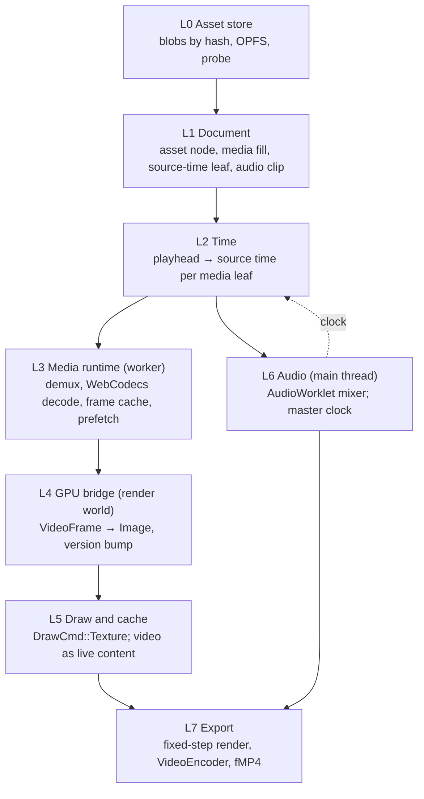

# Video and audio as assets with time

**Status:** Note. A study of Tooscut and a proposal for how its core abilities would
fit Iron. No plan has adopted it, so nothing here should be built yet.
**Date:** 2026-10-15
**Context:** The user sees video as part of Iron's scope. A video is another 2D asset,
except that it plays: it can be moved, arranged, layered and annotated like anything
else. The use case is research labs explaining their work to a wide audience, with lab
footage mixed in with Iron's own animations of the apparatus and its signals. This note
studies [mohebifar/tooscut](https://github.com/mohebifar/tooscut) (commit `98abb0d`,
2026-10-12), a browser NLE built on Rust, wgpu and WebAssembly, and maps it onto
vision docs 01–09.

---

## 0. Summary

1. **Take Tooscut's media pipeline and leave its document model.** Tooscut's document
   *is* the timeline: tracks own clips, and track index is z-order. In Iron the
   document is compositions of figures, and time is relations onto them (doc 05,
   `time.rs`). A video belongs in Iron as a **figure with a media fill whose
   source time is a leaf**, not as a clip on a track.
2. **Iron cannot preview video the way Tooscut does.** Tooscut previews through an
   `HTMLVideoElement` on the main thread. Iron's Bevy app normally runs in a worker,
   where there is no `HTMLVideoElement`. Iron must decode with **WebCodecs in the
   worker** for both preview and export. That is one path instead of Tooscut's two,
   but it means Iron has to do its own seeking, frame caching and prefetching.
3. **Most of the GPU path already exists.** `DrawCmd::Texture` (an `Image` handle and
   a `version`) is the hook. The work is getting a decoded `VideoFrame` into that
   `Image` each frame, and then **stage H's raster cache must treat a playing
   video as live content**, not as a tile that is dirty every frame.
4. **Export is the most valuable piece of Tooscut for Iron, and needs no video
   import.** Rendering a lesson to MP4 through WebCodecs and Mediabunny is what
   carries Iron's work to a wide audience. It can be built first.
5. **Don't link Tooscut's code into Iron.** Tooscut's compositor creates its own wgpu
   24 device, while Iron's Bevy owns a wgpu 29 device, and the repository is under the
   Elastic License 2.0 (§7). Port the ideas, and depend directly on the library
   underneath: [Mediabunny](https://mediabunny.dev).

---

## 1. How Tooscut works

### 1.1 Layout

| Part | What it is |
|---|---|
| `apps/ui` | React 19 + TanStack Start. Zustand store with `zundo` snapshot undo, Konva timeline, Dexie (IndexedDB) for projects |
| `packages/render-engine` | TypeScript: types mirrored from Rust, keyframe evaluator, `frame-builder` (clips → `RenderFrame`), `clip-operations` (edit operations), `video-frame-loader`, audio engine wrapper |
| `crates/types` | Serde types, the source of truth (via `tsify-next`): transform, effects, crop, easing, keyframes, transitions, text, shapes, color grading |
| `crates/keyframe` | Keyframe evaluation (the TS evaluator is the one actually used) |
| `crates/compositor` | wgpu 24 + glyphon/cosmic-text: draws media quads, SDF shapes and lines, text, transitions, and a color-grading chain |
| `crates/audio-engine` | Pure Rust mixer that runs inside an `AudioWorkletProcessor`: sources, clips, tracks, cross-fades, time stretch, EQ, compressor, reverb, noise gate |

### 1.2 Data model

- **Tracks come in pairs**, one video and one audio. Track index is z-order. Clips
  never overlap on a track except during a cross transition.
- **A clip** is `{assetId, trackId, startTime, duration, inPoint, speed, transform,
  effects, crop, keyframes, transitionIn/Out, crossTransition, linkedClipId}`. Times
  are **integer frames** at a rational frame rate (`{numerator, denominator}`), and
  converted to seconds only at the render boundary.
- Clip arrays are **kept sorted by start**, so finding the clips visible at a time is
  a binary search.
- **Keyframes** are per-property tracks of `{time, value, interpolation: Linear |
  Step | Bezier, easing}`.
- **Transitions** (fade, wipe, slide, zoom, rotate, flip) are an enum understood by
  the shader, shared by every layer type.
- **Color grading** is a chain of nodes (primary CDL, lift/gamma/gain wheels, curves,
  3D LUT, HSL qualifier, power windows), with log input spaces (LogC, S-Log3, V-Log…)
  and tone mapping.
- **Assets** are `File`s. Handles from the File System Access API are kept in
  IndexedDB so a project reopens with its media.

### 1.3 A frame

```
store (frames) → getVisibleClips (binary search) → buildRenderFrame (evaluate keyframes)
  → JSON RenderFrame over Comlink → compositor worker → wgpu → OffscreenCanvas
```

The engine is **stateless per frame** so export can render frames in parallel
workers.

### 1.4 Decode

`VideoFrameLoader` has two adapters:

- **Preview:** a muted `HTMLVideoElement` per asset on the main thread. Playing
  forward, the video element plays and each tick captures its current frame with
  `createImageBitmap`. Scrubbing, playing in reverse, or drifting more than 0.15 s
  falls back to seek-and-capture. If one asset is visible twice at once (in a
  cross-fade), each clip gets its own element.
- **Export:** Mediabunny's `VideoSampleSink`, frame-accurate WebCodecs decode, in a
  pool of worker renderers. Videos that WebCodecs cannot decode fall back to a
  main-thread loader.

Frames go to the GPU as `ImageBitmap`s through `copy_external_image_to_texture`.

### 1.5 Playback clock

The video tick advances from `performance.now()` inside `requestAnimationFrame`.
Audio runs in its own `AudioContext` worklet and reports its position about 10 times
a second. The two clocks are not slaved to each other, so they can drift on long
playback. Iron should not copy this (§3.6).

### 1.6 Audio

The Rust mixer runs in the audio worklet. Sources are **windowed**: about 30 s of
decoded PCM per source, evicted around the read position. The main thread decodes
ranges ahead of the playhead with Mediabunny and posts them in. Export uses the same
windowed sources in 10 s steps, so memory stays around 11 MB per source however long
the video is.

### 1.7 Export

N worker renderers each decode and composite. Rendered frames come back as
`VideoFrame`s, go through a hardware `VideoEncoder` on the main thread, and are muxed
by Mediabunny into **fragmented MP4 written straight to a
`FileSystemWritableFileStream`**. Backpressure: at most 4 frames queued in the
encoder and 8 encoded chunks waiting. Two lessons recorded in their design doc are
worth keeping:

- `new VideoFrame(offscreenCanvas)` refers to the swap-chain texture, which the next
  render recycles. Use `transferToImageBitmap()` first, or the encoder reads a
  destroyed texture.
- Close each `ImageBitmap` as soon as it is uploaded, or GPU memory doubles across a
  batch.

---

## 2. What Iron already has

| Tooscut | Iron today |
|---|---|
| Clip on a track with keyframes | `clip` nodes with `Timing` and `Clip {prop, from, to}`, targeting leaves through `animates` relations; `time.rs` samples them into the graph's animated layer |
| Playhead in a separate high-frequency store | The playhead is runtime state, never saved (spine §5.11) |
| Pause undo during drags (`zundo` pause/resume) | Gesture preview, then one transaction on commit; gesture ownership; one undo stack of ops. Iron is ahead here |
| Track index = z-order | Tree order within a composition. Iron's is more general and should stay |
| Compositor quad for a texture | `DrawCmd::Texture { transform, image, size, version }`, drawn by both backends (`src/vector/hybrid.rs`), already used for embedded 3D views |
| A render worker with an OffscreenCanvas | Bevy in a worker (`RuntimeMode = 'worker' \| 'main'`) |
| Text, shapes, lines | Vello paths, text, clips, shadows: much richer |
| Assets as `File`s | Planned: content-addressed blob store and `asset` nodes (`clipboard-and-assets.md` §5 phase 4), blocked on the project container (§6) |

So Iron already has the scripted-time model, undo, and texture drawing. What it lacks
is **assets, decode, audio, a media clock, and export**.

---

## 3. The integration layers



### L0. Asset store

What `clipboard-and-assets.md` §6 already asks for, plus what media needs:

- **Content-addressed blobs in OPFS.** A video can be gigabytes, so hash it while
  streaming it in, never in one read. Lab footage is large enough that copying it into
  OPFS may be unwelcome. Allow a **linked** asset as well, which keeps a
  `FileSystemFileHandle` (Tooscut's approach) and records the hash to detect when the
  file has changed.
- **Probe on import** (Mediabunny): duration, rational frame rate, size, rotation,
  codec, whether there is audio, and whether this browser can decode it
  (`VideoDecoder.isConfigSupported`).
- **Derived media products** are cache entries keyed by the asset hash, never
  document data: thumbnail strips, waveform peaks, proxy transcodes, and later
  transcripts and shot boundaries.
- **Undecodable sources.** Lab cameras produce HEVC, ProRes or raw files that browser
  WebCodecs often cannot read. That needs a transcode path: `ffmpeg.wasm` locally, or
  a server call-out (`projects-labs-and-server.md`). This is doc 02's Model tier:
  slow, expensive, run on commit.

### L1. Document

The key design choice: **a video is a figure, and when it plays is a leaf.**

- **`asset` node** in the library: `{hash, mime, w, h, duration, fps, has_audio,
  name}`, as planned for images.
- **Media fill.** If images become a rect's image fill (the recommendation open in
  `clipboard-and-assets.md` §7.2), a video is the same fill with a media asset.
  Corners, masks, shadows, transforms, layering and annotation all work unchanged.
  That is what "video is like other 2D assets" means in practice.
- **`source_time` leaf** on the fill: which instant of the source to show. By
  default it is a **media timing** on the figure: `{start, in, rate, loop, hold}`,
  giving `source = in + (t − start) · rate` while active. It is still a leaf, so the
  existing mechanisms give the editing features for free:
  - a **clip** on `source_time` is a speed ramp, a reverse or a freeze frame (doc 05
    §2.1: animate a parameter);
  - a **binding** makes it reactive: scrub the footage from a slider, or lock it to a
    simulation's clock so the real experiment and the model play side by side;
  - a **state machine** can play it when a lesson step enters (doc 05 §5.1).
- **Audio clips** are not spatial. They belong to the time layer, either a lesson's
  scenario (`time-machines-and-scenarios.md` §3) or the composition's timeline:
  `{asset, start, in, rate, gain}`, with gain as an animatable leaf. A video's own
  sound is an audio clip **linked** to its figure (Tooscut's `linkedClipId`), so
  moving the video in time moves its sound.
- **What not to import:** track pairs, track index as z-order, a transition enum in
  the renderer. A fade is a clip on opacity. A wipe is a clip on a mask. A named
  transition is a definition: a small named timeline played with `<play>` (doc 05
  §4). A cross-dissolve is two overlapping figures and a `par`.
- **Time type.** The playhead is `f64` seconds. Media needs exact frames: 29.97 fps
  is 30000/1001, and frame *n* must land on frame *n* after any number of edits.
  Keep document times in seconds, and store media `in` points and rates as
  rationals, or as integer ticks of the source's timebase. Snap to source frames only
  at the decode boundary. Decide this before media lands, because it is a file
  format question.

### L2. Time

`time.rs` already samples a pure function of `t`. Media adds one more output: for
each visible media leaf, the source time it needs. Two facts make video a new kind of
participant:

- In the terms of `time-machines-and-scenarios.md` §1, a video is a **clock-driven
  machine without memory**: any time can be reached, so scrubbing works. But reaching
  a time is **expensive**: decode from the previous keyframe, often hundreds of
  milliseconds. It sits between a timeline (instant seek) and a simulation (no seek).
- So time sampling has to report **what will be needed soon** (playhead, rate and
  direction) as well as what is needed now, so L3 can prefetch.

### L3. Media runtime (in the worker, outside the ECS)

A plain Rust/JS service beside the Bevy app, the way `iron_document` sits beside it:

- **Demux** with Mediabunny (TypeScript, runs in workers). **Decode** with WebCodecs
  `VideoDecoder`, which works in a dedicated worker.
- **Sessions:** one decoder per asset per distinct *source time* in use. The same
  asset shown in two compositions at the same time shares a session; at different
  times (a split view of before and after) it needs two, like Tooscut's per-clip
  loader during a cross-fade.
- **Frame cache:** a ring of `VideoFrame`s per session keyed by timestamp, with a
  byte budget. `VideoFrame`s hold decoder memory, and decoders stall if frames are
  not closed promptly.
- **Seek policy:** jump to the nearest keyframe and decode forward. While scrubbing,
  show the nearest frame already decoded and fill in the exact one, the same idea as
  stage H's zoom proxies (vision 01 §5).
- **Decoder budget:** hardware decoders are limited, often a handful per process.
  Visible and playing media have priority. Distant media go to a thumbnail or a held
  frame. This is a scheduling policy alongside stage H's raster queue (vision 07 §8.2).
- **Live sources** use the same path: a webcam or instrument camera through
  `MediaStreamTrackProcessor` is doc 02 §2.5's "live instrument data", a degenerate
  Model with no inputs.

### L4. GPU bridge

- In the render world, copy the frame into the `GpuImage` behind the figure's
  `Image` handle with `queue.copy_external_image_to_texture`, then close the frame
  and bump `version`.
- **Build flag:** in wgpu 29, `ExternalImageSource::VideoFrame` exists only under
  `--cfg=web_sys_unstable_apis`, which Iron does not set (`.cargo/config.toml` has it
  commented out). Without it, use `createImageBitmap(frame)` and the `ImageBitmap`
  variant, as Tooscut does, at the cost of one extra copy. Measure both.
- **Color:** WebCodecs frames are usually BT.709 YUV, and browsers convert them on
  copy. Tooscut's log-space grading (LogC, S-Log3…) would be a shader pass here,
  between the copy and the texture Vello samples, run once per new source frame rather
  than once per display frame. Grading belongs to the media fill (an effect stack on
  the figure), not to the renderer.
- Main mode (`RuntimeMode = 'main'`) could use `HTMLVideoElement` directly, but two
  decode paths cost more than they save. Use WebCodecs everywhere.

### L5. Drawing and the raster cache

`DrawCmd::Texture` already draws the frame. The new problem belongs to stage H. A
playing video **changes every frame**, so in a damage-bounded tile cache:

- tiles under a playing video would rerasterize at video rate, and with them every
  vector primitive that overlaps the video;
- the fix is vision 07 §7.3's compositing barrier: split the display list around
  the video. Content below, the video, and content above are composited as layers,
  and only the video's quad changes. Annotations drawn over footage stay cached tiles.
- Paused, a video is a static texture and can be cached like an image.

Tell the render track (`handoff-render.md`) before images land: media fills change
stage H's cache keys and its classification of live content.

### L6. Audio

- `AudioContext` exists only on the main thread, so the mixer lives on the Svelte
  side in an `AudioWorklet`, as in Tooscut. Its design is sound: a Rust mixer
  compiled to a small separate wasm module (not part of the Bevy wasm), windowed PCM
  sources fed ahead of the playhead, fades and cross-fades as gain curves.
- **The audio clock is the master during playback.** The worker's playhead follows
  `AudioContext` time sent across (plus a latency estimate), not its own
  `performance.now()`. This fixes the drift in §1.5. With no audio playing, the
  worker's clock leads.
- **Narration matters for this use case.** Recording a voiceover against the
  playhead (`MediaRecorder` into a new audio asset and clip) is probably worth more
  to a research explainer than EQ or reverb.

### L7. Export

A **deterministic offline render**, separate from live playback:

- Step the playhead at exact rational frame times. **Wait** for every media frame and
  every pending raster job instead of dropping frames. Render the lesson's
  composition view. `view-textures.md` already gives each view its own texture, which
  is the natural export target at a fixed output size.
- Read back with `transferToImageBitmap()`, then `VideoFrame`, then `VideoEncoder`,
  then Mediabunny fMP4 to a `FileSystemWritableFileStream` or OPFS, with Tooscut's
  queue caps for backpressure.
- Audio is rendered offline by the same mixer in windows.
- **Determinism is a prerequisite:** seeded randomness (doc 06 §4), solver results
  that do not depend on frame timing, and simulations stepped at a fixed `dt` during
  export. A lesson that includes a live simulation exports correctly only if the
  simulation advances by export time, not by wall-clock time.
- **Parallel export** (Tooscut's worker pool) needs a stateless frame. Iron's
  simulations have memory, so export is sequential at first. Pool only memoryless
  segments.
- This layer needs nothing from L0–L4. **Lesson → MP4 can ship before video import
  does.**

### L8. Editing surface

- Timeline rows for media clips, with thumbnails and waveforms from L0's derived
  cache, generated in the worker.
- Trim, slip, split, ripple and roll as ops on `Timing` and the media timing. Tooscut's
  `clip-operations.ts` (sorted-clip invariant, overlap rules, linked-clip propagation)
  and its 76 tests are a useful specification to port from.
- Ripple is a timeline-level operation. In Iron it falls out of the planned temporal
  solver (`seq` with flex: removing a child closes the gap), rather than Tooscut's
  per-track shift code.

### L9. The language model

- A media fill projects as `<video asset="#a3" in="12.4s" rate="1" dur="6s"/>`, with
  the decoded frame never sent.
- The model cannot watch footage, but it can read **derived text**: a transcript (a
  speech-to-text Model call-out), shot boundaries, and per-shot captions. These are
  semantic-layer data (doc 04 §10) keyed to time ranges of the asset. "Cut to the
  part where she aligns the fiber" then becomes a lookup.

---

## 4. What this makes possible

The use cases that only work because Iron is not an NLE:

- **Annotations that follow the footage.** An arrow targets "the modulator in this
  shot". A tracking Model (a call-out, run once) turns a region of the video into a
  time-series signal, and a binding pins the arrow's position to it. This is vision
  09's annotation-points-at-an-entity rule extended to video.
- **Footage and model in lockstep.** The video's `source_time` and the simulation's
  clock read one master time (or one is bound to the other), so the real oscilloscope
  trace and the modelled one play side by side.
- **Recorded simulations as media.** "Record to scrub" (`constraint-system.md` U6;
  time-machines note §1) can store a run as a media asset: frames as video, signals
  as time series. A simulation with memory becomes scrubbable through the same L3
  path as footage.
- **Video as a figure in 3D.** A media fill on an image plane (clipboard spec phase
  5) puts lab footage on a surface of the 3D assembly. The GPU bridge is the same.

---

## 5. Suggested order, when a plan adopts this

| Stage | Contents | Needs |
|---|---|---|
| V0 | **Lesson → MP4 export**, silent: fixed-step render, WebCodecs encode, Mediabunny mux | View textures (done); deterministic stepping |
| V1 | Image assets and the project container | `clipboard-and-assets.md` §6 and phase 4 |
| V2 | **Video fill plays**: import and probe, worker decode, frame cache, GPU bridge, `source_time` leaf driven by the playhead. Scrub and play, no audio | V1 |
| V3 | Audio: worklet mixer, linked audio clips, audio-master clock, narration recording, audio in export | V2 |
| V4 | Timeline editing: trim, slip, split, ripple; thumbnails and waveforms | V2; the temporal solver helps |
| V5 | Live-content compositing barrier in the raster cache | Stage H tiles |
| V6 | Grading and effect stack on media fills; tracking annotations; transcripts for the model | V2; Model call-outs |

V0 is independent and delivers the "explain to a wide audience" use case straight
away. V5 is needed as soon as stage H tiles and V2 both exist, whichever lands
second.

---

## 6. Open questions

1. **Image fill or image node** (`clipboard-and-assets.md` §7.2). Video inherits the
   answer, which leans further towards a fill.
2. **Rational time** in `iron_document`: media fields only, or the playhead too?
3. **Copy or link** large media into OPFS, and what a bundle (zip) does with a 4 GB
   linked file.
4. **Browser support.** WebCodecs decode for H.264 is broad. HEVC, AV1 and VP9 vary
   by browser and hardware. Which formats are promised, and is the transcode path
   local (ffmpeg.wasm, slow and large) or on the server?
5. **Where the lesson's master clock lives** when there is audio, a simulation and
   video together. This note says audio leads. Does the time map (time-machines
   note §3) sit between that clock and physical time?
6. **Export resolution and the raster cache.** Export at 4K with zoom buckets tuned for
   the screen. Does export bypass tiles and render the view directly?

---

## 7. Licence

Tooscut's `LICENSE` is the **Elastic License 2.0**, with a CLA. It allows copying and
modification, but forbids offering the software to third parties as a hosted or
managed service. The Cargo workspace metadata says `MIT` and the root
`package.json` says `ISC`, but those fields do not override the `LICENSE` file. If
Iron may become a hosted service (`projects-labs-and-server.md`), **do not copy
Tooscut code**. Read it as a reference and reimplement. The parts most tempting to
copy are the audio mixer (`crates/audio-engine`, pure Rust, no wgpu) and the
color-grading WGSL. Mediabunny is a separate project with its own licence; check it
before adopting it.

## 8. Sources

- [mohebifar/tooscut](https://github.com/mohebifar/tooscut): `README.md`, `CLAUDE.md`,
  `packages/render-engine/docs/DESIGN.md`, `video-frame-loader.ts`,
  `apps/ui/src/components/editor/preview-panel.tsx`, `crates/compositor/src/`,
  `crates/types/src/`, `apps/ui/src/lib/frame-renderer-pool.ts`
- [Mediabunny](https://mediabunny.dev)
- wgpu-types 29.0.4 `src/texture/external_image.rs` (the `VideoFrame` variant behind
  `web_sys_unstable_apis`)
