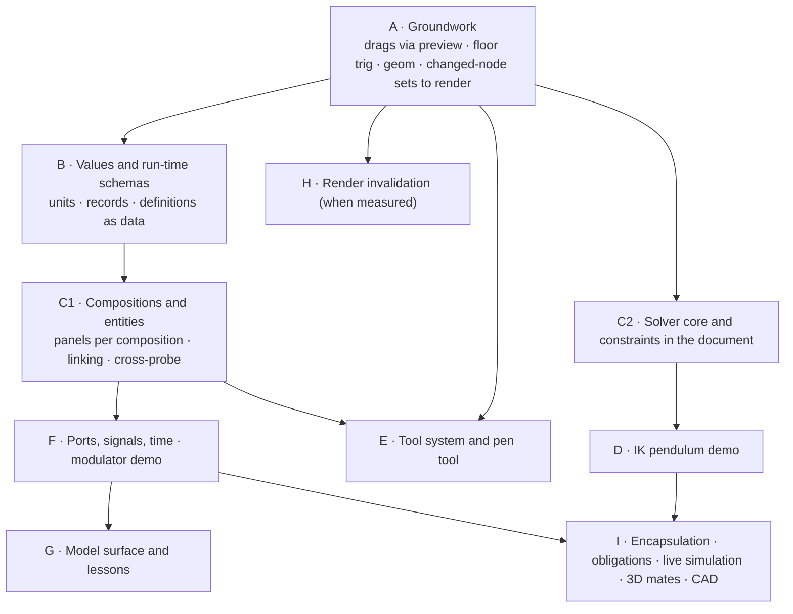

# Roadmap: from the document spine to the intended tool

**Status:** Proposed — living document; update the stage table as work lands
**Date:** 2026-10-09
**Scope:** What a design conversation (2026-10-04 to 10-09) clarified about how Iron is
meant to be used, what that means for the code on branch `document-spine`, and the
order in which to change it. It indexes three companion documents:

- [`vision/09_entities-compositions-and-ports.md`](vision/09_entities-compositions-and-ports.md)
  — the representation model across levels of abstraction (the *why*);
- [`entity-composition-model.md`](specs/entity-composition-model.md) (**ECM** below) — units,
  definitions, entities, ports, signals, compositions, lessons (the *how*);
- [`constraint-system.md`](specs/constraint-system.md) (**CS** below) — constraints,
  interaction-time causality, live simulation.

Ideas discussed but not adopted live in `plans/notes/`; do not build from them until a plan adopts them.

Reconciled on 2026-10-10 against the working tree, where spine steps 6 (clips and the
timeline, `time.rs`) and 7 (the model surface, `src-ui/model/`) are done but not yet
committed. Commit those first, so this work starts from a clean base.

---

## 1. What the conversation clarified

Each item is a decision or a clarified intent, with where it is worked out.

| # | Clarification | Consequence | Where |
|---|---|---|---|
| 1 | `iron_document` is the right foundation: an authored store above Bevy's runtime ECS, as Blender's scene data sits above its depsgraph. Do not fork Bevy | Keep the layering; keep the store thin | §2 |
| 2 | The registry should hold primitives only. Domain things (`bar`, a laser, a fiber) belong in data | Definitions as data; `bar` leaves the registry | ECM §4 |
| 3 | The tool should guide users toward **models plus signal-based inference and visualisation**, with **CAD-style constraints for setting things up** | Two mechanisms with separate jobs: signals and models for physics; constraints for placement | Vision 09 §0, §7–8 |
| 4 | Humans want to grab anything and see what happens, and which side moves is decided at the moment of the grab | Constraints with interaction-time roles; drags through the solver | CS §3, §8 |
| 5 | Common simulation primitives should run in-process at 60 fps, even though doc 02 frames Models as slow call-outs | Floor-tier simulation and model primitives; external Models remain the slow tier | CS §11; vision 09 §7 |
| 6 | Both kinds of path: static ones, and flexible ones that forces act on | Path points as child nodes; one representation for both | CS §13 |
| 7 | **Linking representations across levels of abstraction is central**: a modulator in a schematic, a 3D assembly, and a cartoon | Entity, figure, composition, notation; hub-and-spoke linking | Vision 09 §2–4 |
| 8 | Ports are typed interfaces carrying values with units, structured values, or time series | Units and records early; runtime signals | ECM §3, §6 |
| 9 | A connection carries a signal one way and may imply a constraint (a lens on a beam's rail) | Port kinds declare implied mates | Vision 09 §6; ECM phase 7 |
| 10 | Not every face is a port. Brackets and mate features are local geometry | Ports are semantic; mates stay in their composition; ghost lines stay sparse | Vision 09 §6 |
| 11 | Abstract-to-detailed linking can be under-determined (the bolt) | Derivable, choice, or obligation; strictness deferred | Vision 09 §5; ECM §8 |
| 12 | Annotation is its own layer: it belongs to a lesson and points at the thing | Lessons, steps, annotations with owner and target | Vision 09 §9; ECM §10 |
| 13 | The LLM should hear about causes, not every inferred effect | Notification policy; `.by` markers; obligations as a view | CS §9; ECM §11 |
| 14 | Category theory gives laws, not vocabulary | Six laws become tests | Vision 09 §11 |
| 15 | Users and the LLM can define new notations, as they can build editors | Notations as data | Vision 09 §10 |
| 16 | Rendering should cull before caching; Understory's spatial crates fit the missing middle layer | Independent bounds and `understory_index` now implemented; evaluate box-tree ownership separately | §5 |
| 17 | The pen tool and a tool and mouse-context system can start now, independent of caching | Tools as state machines that emit ops and previews | §4 |
| 18 | Drags that only commit on release are fine for undo, but bound and constrained things must respond *during* the drag. Today a drag locks any axis that is bound or clip-driven | All drags go through `preview`; linear bindings invert directly; constrained axes go through the solver instead of locking | §3 stage A |

---

## 2. What stays exactly as it is

These are the spine's strongest decisions, and nothing above weakens them:

- every mutation is an op inside a transaction; inverses are computed at apply time;
  one undo stack;
- stable `NodeId`s, never reused; tombstones; fractional order keys;
- authored versus derived: the file holds only what someone authored; signals,
  resolved bindings, solver previews, and obligations are derived;
- canonical JSON with flat tables;
- the gesture overlay in the store, so manipulation never crosses a process boundary;
- Bevy as a derived consumer, with a `NodeId` ↔ `Entity` map and provenance.

The new concepts are all expressed through these: entities, ports, connections, and
constraints are nodes; links are relations; consistency is computed.

---

## 3. Stages

| Stage | Work | Why now | Exit | Detail |
|---|---|---|---|---|
| **A** Groundwork | Position drags through `Store::preview`, with a post-drag reconcile so nothing lags; `sin cos atan2 sqrt …` in the floor; a `geom` module with world transforms equal to Bevy's; the reconciler's changed-node set passed to rendering instead of one `DocumentDirty` boolean; per-node 2D bounds; **linear binding inversion** (below) | Small, independently useful, and everything later builds on them | A rect bound to another follows it during the drag, not after; dragging a node whose `x = 2·v + 10` sets `v`; render reports which nodes it redrew | CS phase 0 |
| **B** Values and schemas | `Quantity`, `Record`, `Get`; interned field symbols; definitions as data; `bar` becomes a definition | The file format is cheapest to change now, and ports, signals, and definitions all store these | ECM phase 1 exits | ECM §3–4 |
| **C1** Compositions | Model and composition roots, `figures`, one panel per composition, selection by `NodeId`, cross-probing, Show in, Link | The central idea of vision 09, and every later demo needs two or more panels | ECM phase 2 exits | ECM §5, §7 |
| **C2** Constraints | `iron_solve`; constraint nodes; solve-on-apply with `derived_ops` | Independent of B and C1 (pure geometry inside one composition), so it can run in parallel | CS phases 1–2 exits | CS §4–7 |
| **D** IK demo | The pendulum: drag the ball or the platform; a length slider; the LLM notification | The first proof of interaction-time causality, and of telling the LLM causes rather than effects | CS phase 3 exits | CS §14 |
| **E** Tools and pen | Tool state machines; a tool-context resource; a hit-test interface; the pen tool creating paths of point nodes | Asked for soon, mostly independent of caching, and forces the path representation decision early | Draw, close, and edit a path; each click is one transaction; undo per point | §4 |
| **F** Ports and signals | Port kinds, connections, the signal graph; laser → fiber → meter; then time series and the modulator in three compositions | Delivers the "linked representations animate together" goal | ECM phases 3 and 5 exits | ECM §6 |
| **G** Model surface and lessons | Extend the existing model surface (`src-ui/model/`, `document_apply`) with `Model`, `Composition`, and `Lesson` views, the new verbs, solver summaries, and obligations; lessons and annotations | The surface exists and works on the raw tree; it should move to the semantic views as soon as they exist | ECM phase 6 exits | ECM §10–11 |
| **H** Render invalidation | Measure per-panel frame cost; independent bounds and indexed picking/culling implemented; retained overlay targets and presentation chunks next; caching where culling is not enough | Only when measurements say so (doc 07; `bevy-vello-hybrid-design.md` §6) | A local edit redraws only damaged content; frame time with 4 panels is within budget | §5 |
| **I** Later | Encapsulation and obligations (ECM 4); live simulation with grab (CS 5); 3D mates (CS 6); implied constraints and CAD tagging (ECM 7); simulated paths (CS 7) | Each builds on two or more earlier stages | Per document | — |

### Status

| Stage | Status |
|---|---|
| **Computational Model interop (proposal)** | **Planning only, 2026-10-16:** [`specs/model-interop.md`](specs/model-interop.md) proposes portable jobs and live sessions over WebSocket/binary data, with optional local acceleration; shared ownership, revisions, clocks, bounded buffering and native ECS concurrency requirements. Bulk outputs remain runtime data and bypass the UI transport. **Pending user approval; no implementation or test results.** Conditional work order: `handoff-product.md` §4.2. |
| **Native target (feasibility)** | **Plan revised 2026-10-16:** [vision 08](vision/08_native-target-via-tauri.md) now defines a shared web/native engine and UI boundary, small platform adapters, single-window macOS feasibility gates and parity/regression evidence. A bounded experiment is independent of raster caching; work order is in `handoff-product.md` §4.1. **Feasibility implementation transferred to the main `document-spine` checkout on 2026-10-16 at the user's request;** standalone composition passes dev/packaged tests and the packaged shared Svelte/Metal workspace passes 15 checks and the 100,000-runtime-entity fixture passes 17, proving parallel ECS and render/simulation overlap. Native operations delegate to the same Rust engine API as wasm. Both wasm builds and full run-iron smoke pass. The title-bar content-area mismatch is corrected and pointer motion now bypasses JS through AppKit. Human follow-up found title-bar translucency and latency waves: opaque window backing is fixed; four CPU pacing comparisons identify drawable backpressure, with FIFO/2 becoming the provisional native default and awaiting human retest; Immediate/2 retains callback jitter and remains diagnostic. Human latency is now reported as decent. A packaged CSP rejection of generated cursor images is fixed, with native 2x rasters and useful CSS fallbacks; six cursor checks pass. Remaining display/parity/cost gates are open in the owning plan. Full port, agent harness and additional platforms remain unscheduled. |
| **A** | **Done 2026-10-10** on branch `roadmap`, one commit per item: floor functions and `pi` (`expr.rs`); `geom.rs` with `Store::world_affine`, matched against Bevy by a glam test and a runtime drift check; linear binding inversion (`handle.rs`, `Store::handle`, `Store::preview_target`, `tests/handles.rs`); all position drags through `Store::preview` with `document_bridge::reconcile_gesture` before transform propagation; `DocumentChanges` (the changed-node set plus a structure flag) and `Bounds2d` replace `DocumentDirty`, and the 2D layer logs `redraw (reason): N of M nodes changed [ids]; damage …`. Exit verified in headless Chrome by the run-iron smoke script: the demo's new "shadow" rect (bound to the square) reads the previewed position mid-drag and the screenshot `mid-drag-bound-follows.png` shows it; dragging the bar (`y = 640 − 300·v`) sets the slider in one "move bar" transaction; each drag frame logs the two redrawn nodes and their damage rect. Still re-encodes the whole layer; stage H uses the set to cull |
| **View navigation tuning** | **2026-10-16:** shared Ctrl/Cmd-wheel accelerated-event log-zoom cap raised 0.05 → 0.065 (about 5.1% → 6.7% per event); small-delta response unchanged. Knobs are `ZOOM_STEP` / `ZOOM_PER_PX` in `src/bevy_app/input_accum.rs`, with no UI setting. See `specs/select-tool.md`. |
| **C2** phase 1 | **Done 2026-10-10**: `src/iron_solve`, a dependency-free crate (projected Levenberg–Marquardt with required/strong/weak tiers, clustering, rank analysis naming redundant and conflicting terms). Every CS phase 1 exit test passes natively; the 12-variable benchmark solves in 280 µs native and ≈490 µs in the dev-opt wasm build (`__iron.bench`). Details and deviations in CS §14 phase 1 |
| **C2** phases 2–3 and **D** | **Done 2026-10-11**: constraint nodes, clusters, solve-on-apply with `derived_ops`, `Applied.solver`, `exact`, cycle checks, `.by` markers, the store's drag API (`constraint.rs`, `solve.rs`, `tests/constraints.rs`, golden view); the pendulum demo with every CS phase 3 exit in the smoke script, verified in headless Chrome. Details and deviations in CS §14 phases 2 and 3 |
| **C1** | **Done 2026-10-11** (ECM phase 2), one commit per step, after the `depiction` → `figure` rename (schema 3): root-only `composition` and `model` types (`composition.rs`); one panel per composition (render layers, a camera per 3D panel, per-panel 2D drawing, picking and drags; measured 60 fps at 1, 2 and 4 panels on the GPU, so no fallback); selection by `NodeId` with cross-probe highlights; `Store::link` with the merge question, Show in; `model` and `composition` views with golden files and `<link-figures>` on the model surface. Every phase 2 exit verified by the smoke script. Details and deviations in ECM §12 phase 2 |
| **E** (select tool) | **First part done 2026-10-11**, before the pen tool: Figma's selection, drag and transform semantics (`bevy_app/select.rs`, plans/specs/select-tool.md). Hits carry their chain through groups and embeds; a click selects the outermost node whose container is not open, and top-level embeds act as artboards. The box resizes, rotates and moves through store previews, one transaction per gesture. Also: a marquee, the Esc/Enter/Tab/Cmd+A/arrow/Delete shortcuts, and shell cursors. Undo of a deleted subtree whose nodes bind to each other was fixed in the store. Verified by the smoke script's select-tool section. **Pen done 2026-10-12:** `path` and `point` nodes with `handles` leaves; the pen tool (P), one transaction per point, closing on the first point, undo per point; point and handle editing; the exit (draw, close, edit, undo per point) verified by the smoke script; see plans/specs/select-tool.md. **Shapes and toolbar done 2026-10-14:** Figma's shape model: `circle` became `ellipse` (`rx`, `ry`; schema 4, older files migrate) and stretches; a rect or ellipse becomes a path with the same id on double-click or Enter, asking first only when that cuts a binding or clip (`iron_document::shape`); rectangle (R) and ellipse (O) tools; a bottom toolbar in 2D views replaces the tab-bar tools; larger grips. See select-tool.md "Shapes and paths". **Corners, arcs and shadows done 2026-10-14:** rect corner radii and ellipse arcs with Figma's on-canvas handles, drop shadows (Vello's analytic blurred rect for rects, a filter layer otherwise), gestures that add a component in one transaction; see select-tool.md "Corners, arcs and shadows". **Copy, paste and duplicate done 2026-10-15:** `iron_document::copy` takes a selection's closure (the entities its figures picture, connections, constraints and clips wholly inside it) and pastes it as one transaction with fresh ids; Cmd+D duplicates in place, Cmd+C/X/V go through the system clipboard; see plans/specs/clipboard-and-assets.md. **Gesture ownership, first pass, done 2026-10-15:** a gesture has an id and watched nodes in the store; a transaction from outside it applies without its previews and either cancels it (a conflict: nothing commits on release) or leaves it running; undo cancels it; the inspector edits through `set_through_handle` instead of the shared overlay; see plans/specs/infinite-canvas-architecture-patterns.md §4 "First pass". **One pointer state machine, the 3D gizmo and Alt-drag done 2026-10-15:** every document edit, 2D or 3D, is one manipulator under the store's gesture (`bevy_app/manipulate.rs`; the separate `DragState` path is gone); `transform-gizmo` moves, rotates and scales selected meshes in 3D panels and 3D embeds, previewing through the store and drawn in an overlay vector view; Alt during a move duplicates and drags the copies, undone in one step; see infinite-canvas-architecture-patterns.md §4 "Second pass" |
| **F** | **Phase 3 done 2026-10-12** (ECM §6.1, steps 1–3): port kinds with one-way and across/through variables; ports, connections, signals derived by the graph; laser → fiber → meter in an Optics (cartoon) and a Schematic composition; two-way editing (the meter gauge drags the laser's power back through the chain); rf→optical rejected; the model view shows the chain. Step 3: across/through pairs solved as equations into a derived physics layer (a heater, a thermal link and an ambient sink in a Thermal tab). Verified by the smoke script's stage F sections and `tests/ports.rs`. Next: phase 4 (consistency and encapsulation) or phase 5 (time-domain signals, the modulator) |
| **H** | **Measurements and first interaction fix done 2026-10-13:** stress fixture and phase timers; 1k/10k remeasured with shipped wasm SIMD (`render-benchmark.md` §6). Shared selection/hover geometry cache removes the unchanged-frame subtree walks: at 10k, selected idle frame 119 → 2.7 ms and hovered idle frame 13.7 → 2.7 ms (idle 2.7 ms; worker CPU p50). Cache covers resolved previews, playhead, same-version load, and transform-propagation timing; view pan/zoom is applied without rebuilding geometry. DPR 1/2 browser checks validate the benchmark coordinate correction. Change-driven 2D picking and independent bounds/indexed per-view culling are now implemented (§7): resting 10k frames 0.9 ms; zoom-1 pan 5.3 ms, drag 6.0 ms, rotation 17.9 ms. All 95 native tests, full smoke, and DPR 1/2 reference/image/cache checks pass. **Retained overlay target done 2026-10-14** (`render-benchmark.md` §9): editor feedback renders into its own view per 2D panel, groups light by their frame (Figma); a hover change at 10k encodes no content (changed frame 2.1 ms), and the 1k selected-group drag at 5K drops 11.8 → 8.7 ms. Shared subtree summaries, chunks and subtree caching remain. **Group-local spatial scene done 2026-10-17** (`render-benchmark.md` §10; vision 10 phase 1): the store's `geom::Revisions` split placement from local changes and `iron_spatial::Scene` indexes each group in its own space, so rotating the 10k field rewrites one entry instead of 10,002 and the bounds phase falls below 0.1 ms; `prepare_spatial` reads no Bevy transform. **Vision 10 phase 2 done 2026-10-17** (`render-benchmark.md` §11): document entities are flat and transform-free in 2D, Bevy consumes the store's affines, and the 10k rotation's changed frame drops a further 67 → 27 ms on the container (`propagate` 0.1 ms). **Vision 10 phase 3 done 2026-10-17** (`render-benchmark.md` §12): draw data lives in `Drawables` by node and only the selection's neighbourhood (Live, budgeted) and 3D nodes have entities; a 100k-shape composition idles at 2 entities. **Bevy 0.20 / wgpu 30 / `vello_gpu` 0.3 upgrade done 2026-10-17** (`render-benchmark.md` §13): `bevy_vello` and the `classic` feature dropped, the 3D embed texture is an external-texture image paint, smoke/spatial/picking pass unchanged. **Vision 10 phase 4 done 2026-10-17:** one runtime signal layer with producer ids, conflicts and a freeze (`tests/signals.rs`), and the piston demo's gas producer in Bevy (`document_bridge/gas.rs`, `piston.txt`). **Next:** key the selection cache on subtree revisions, then chunks with subtree baking (now with `TargetInit::SrcOver` available); Vello is not forked. Work order: `handoff-render.md` §4 |
| **SVG** | **Export and import done 2026-10-15** (plans/specs/svg-import-export.md phases 1–2): `src/iron_svg` writes a 2D composition or the selection as SVG from resolved values, Iron's parameters in `data-iron-*` attributes, and reads SVG (usvg, plus an exact pass over Iron's own elements) into a copy `Fragment` placed by the paste path as one "import SVG"; foreign rects and ellipses are recognised as such. **Paths with holes and stroke style done 2026-10-15** (phases 3–4): `contour` nodes under a `path` with `path.fill_rule` (schema 5, older files migrate), and stroke joins, caps, miter limit and dashes, carried by SVG both ways. Initial opacity, gradient fills and clip frames are recorded in the appearance row below. Paste, drop, Load, `__iron.importSvg`, the model's `<import-svg>`; Export SVG and Copy SVG in the Document view, Alt+Shift+C. Every loss is reported as a cut. Golden file, the round-trip law and Figma/Inkscape/nested fixtures natively; the smoke script exports Controls and imports the Figma fixture. |
| **2D appearance / inspector** | **Initial pass 2026-10-15:** optional `appearance.opacity` isolates a shape (including fill, stroke and shadow) or an entire group's overlapping children; `gradient` provides two independently bindable colour stops and linear/radial geometry in local bounds; `group_clip` clips descendants to a local rectangular, rounded or elliptical frame. Both display-list backends support gradients and isolated opacity; picking respects clip frames. Inspector rebuilt with sectioned paired fields, Bits UI selects, Lucide icons, percentages/degrees and Alt-drag numeric scrubbing through token-checked store gestures (one undo, Escape/cancel, concurrent edits). SVG exports these and restores Iron-authored values exactly; foreign group opacity stays isolated. **Inspector organisation follow-up:** corner radius joins opacity under Appearance with equal-width icon inputs and a compact individual-corner disclosure; compact paint rows and Bits UI detail popovers organise Fill/Stroke; Drop shadow is an entry under Effects. Linked corners, colour alpha scrubs and fill-type changes remain one undo step. **Embed clipping correction:** automatic composition frames include painted stroke outsets (also in SVG export); explicit frames retain authored clipping. **Remaining:** arbitrary shape references for clipping, more than two gradient stops, gradient strokes, general foreign gradient/clip import, and authoring the inspector itself as a session composition. |
| **Text** | **Scaffold done 2026-10-17** ([`specs/text.md`](specs/text.md)): a Bevy-free `src/iron_text` crate (parley 0.11 + skrifa 0.44, the versions `bevy_text` already links) lays out text and caches glyph outlines; `text` nodes with `text` and `font` components, bounds through layout, and re-measurement when a font arrives (`Store::refresh_text`); glyphs drawn as one fill path, so fill, stroke, gradient and shadow apply. Fonts: 15 self-hosted variable families fetched in the worker only when needed, Cache API, picker previews from a generated `previews.json`; installed fonts on the native host (`iron_text/system`). Figma's text tool (T: click auto-width, drag fixed; double-click or Enter edits) through a hidden textarea, one undo per edit. `fmt`/`sci`/`str` make readouts: content bound to `"level = " + fmt(#O.slider.value, 3)` follows the slider live. Text inspector section with a Figma-style font picker. Same day: colour emoji (COLR v1 glyphs replayed as display-list clips, gradient fills and blend layers; Noto Color Emoji split into 10 single and 8 sequence chunks fetched on demand), styled parts (`text.runs`: weight, italic, size, family, colour, underline, strikethrough per range; ⌘B/I/U/⇧X and the inspector style a selected range), plain-text paste makes a text node, SVG export writes `<text>`/`<tspan>` at Iron's layout. **Next:** glyph atlas rendering via `vello_gpu` `text` (render track), SVG `<text>` import, range-aware inspector values |
| **Components** | **Phase 0 done 2026-10-18** ([`specs/component-model.md`](specs/component-model.md)): the store's typed node data is renamed `Facet` (`facet.rs`, `FacetKind`, `Op::AddFacet`/`RemoveFacet`, `Document::facet`/`facets_of`), so "component" is free for reusable definitions. Serde names keep the file, the op wire format and the model surface unchanged; smoke output identical to HEAD. **Next:** phase 1, `in` ports replace parameters (schema 6) |
| **B** | **Done 2026-10-10** (ECM phase 1), one commit per item: registry primitives only (`bar` out); quantities with units (`units.rs`, `Value::Quantity`, dimension-checked floor, quantity literals, file form `{"q": [si, "W"]}`); run-time fields by interning (`sym.rs`, the dynamic `params` component); `Value::Record` and `Expr::Get`; definitions as data (`definition.rs`: `library`/`definition`/`param_spec`/`depiction`/`entity`, `depicts` (since renamed `template` and `figures`, schema 3), validation, instantiation by template copy with reference rewriting). File schema 2, schema 1 still loads. The demo's bar is a definition instantiated into an entity whose `level` is bound to the slider. Decisions taken as the §7 defaults (units) and recorded with deviations in ECM §12 phase 1. Verified natively (`tests/values.rs`, `tests/definitions.rs`) and in the browser by the smoke script |

**The playhead is already shared.** Spine step 6's `time.rs` keeps the playhead in the
store and feeds clip values into the graph's animated layer. Stage F's time-dependent
signals read the same playhead, so a clip and an RF drive stay in step.

**Coordination between B and C2.** Both add registry types (`constraint` in C2;
`definition`, `entity`, and the rest in B and C1). If they run in parallel, land B's
"primitives only" registry change first, so C2 adds `constraint` to the new shape.

### Linear binding inversion (stage A)

Inkling's lesson, applied without a solver: when a dragged leaf is bound to an
expression that is linear in exactly one constant leaf (`x = 2·v + 10`, or
`x = #slider.value * 300`), the drag can set that leaf exactly by inverting the
expression. The gesture previews the source leaf, and the commit writes it. Anything
non-linear, or depending on more than one free leaf, keeps today's snap-back until it
belongs to a constraint cluster. This removes most of the "derived; snapping back"
refusals cheaply, and it is the policy doc 02 §8.2 lists as "edit the underlying
source if the binding is a direct reference", generalised to linear references.

---

## 4. The tool system (stage E)

- **A tool is a state machine** (doc 06 §2: state machines before general handlers).
  States, transitions on pointer and key events, and guards. The pen tool's states:
  idle → placing anchor → dragging handle → (placing anchor | closing) → idle.
- **Tools emit ops and previews only.** They never write Bevy components. Each placed
  anchor is a transaction; the rubber-band segment to the cursor is a preview. Undo
  removes one point.
- **A tool context** resource holds the active tool, modifier state, and the
  composition under the pointer (from the panel map of ECM §7).
- **A hit-test interface** (`hit(panel, point) → Option<NodeId>` and
  `hits_in(panel, rect)`) hides whether hits come from Bevy picking today or the box
  tree later.
- **Paths:** a `path` node with `contour` children holding `point`s (schema 5, so a path
  can have holes), each point with its own `transform2d`. Point
  handles are leaves on the point, or child nodes if they need their own ids. Every
  point can then be constrained, bound, simulated, and annotated like any other node.
- **Borrow:** Understory's `understory_event_state` (click and drag recognition, hover
  transitions), `understory_selection` (selection with primary and anchor), and
  `understory_precise_hit` (hit-testing filled Béziers) are small, self-contained, and
  fit here directly.

---

## 5. Render invalidation (stage H)

**Four hierarchies, kept separate.** Vision doc 07 §4 already separates authoring groups
from presentation chunks and raster cache entries. Vision 09 adds one more level above
them. From most semantic to most physical:

1. **The model tree**: entities and refinement (what things *are*). Never drawn.
2. **The composition's layout tree**: groups, figures, and local geometry (how a
   diagram is *arranged*). Stable, authored, edited by people and the LLM.
3. **Presentation chunks**: derived, contiguous runs of draw commands grouped by how
   often they change and where they sit (what gets *re-encoded together*).
4. **Raster cache entries**: world-space tiles per zoom level, baked subtree images,
   and temporary gesture proxies (what gets *re-rasterised together*).

Each level can be regrouped without touching the ones above it. Baking a static,
zoomed-out group into an image (`bevy-vello-hybrid-design.md` §6: "grouped ⇒ baked to
atlas; edit mode ⇒ live re-encode; bake aggressively at low zoom") is a decision at
level 4. It never changes the layout tree or the model.

Findings from reading Understory's source (`forest-rs/understory`, August 2026):

- **`understory_box_tree`**: local transform, bounds, clip, and z-order per node;
  `commit()` returns damage rects (the old and new bounds of moved nodes, and the
  bounds of removed ones). This is doc 07 §5.1 almost verbatim.
- **`understory_index`**: a 2D bounds index with flat, grid, R-tree, and BVH backends.
  This is the culling step.
- **`understory_presentation`**: drawing primitives keyed by caller ids, with a
  deduplicated dirty list.
- **None of them emit renderer commands or cache rasters.** They cover levels 2–3's
  bookkeeping (world bounds, damage, culling, dirty primitives), roughly a third of the
  missing middle. Ours to build: forming presentation chunks, encoding them for Vello,
  baking subtree images and tiles per zoom bucket, the atlas allocator (`etagere` or
  `guillotiere`), compositing cached images in Bevy, promotion and demotion policy, and
  memory budgets with eviction (doc 07 §5–8). `understory_index` and `understory_box_tree` use recycled generational handles;
  the index can carry `NodeId` as payload and keep those handles private.
  `understory_presentation` accepts caller-owned ids.
- **The core crates are unpublished** (only `understory_view2d` is on crates.io). Pin a
  git commit or vendor them.
- **Implemented foundation (2026-10-13):** `DocumentChanges` retains the changed-node
  set; non-drained projection revisions drive cached selection and picking.
  `SpatialScene` prepares distinct geometry/paint/interaction bounds after Bevy
  propagation, including hidden compositions. `iron_spatial` pins `understory_index`
  at `2ac7efbc010c8ee4daa316c34eadc0bafacfe83b`, carries `NodeId` payloads,
  batches sparse/dense updates and reports painted damage. Indexed candidates feed
  precise picking and per-view/embedded-occurrence culling in painter order.
  See `render-benchmark.md` §7 and `infinite-canvas-architecture-patterns.md` §13.
  Partial raster invalidation, shared subtree geometry summaries, independent overlay
  targets and caches remain unfinished; stage H is not complete.

The ownership question is settled (2026-10-17,
[`vision/10_engine-boundary.md`](vision/10_engine-boundary.md)): Iron computes world
transforms for every document node, 2D and 3D, in a retained pass keyed on per-subtree
local and placement revisions; Bevy entities receive them and never propagate document
nodes; `understory_box_tree` stays rejected. Entities exist per presentation mode (Live
subtrees and 3D renderables only), and values return from Bevy through runtime signals,
not per-frame ops. The work order is that document's §7.1; phases 1–4 landed
2026-10-17 (see the H row), and phase 5 is `handoff-render.md` item 4.

---

## 6. Amendments to existing plans

| Document | Amendment |
|---|---|
| `document-spine.md` §5.10 | A bound or clip-driven axis is locked during a drag, *except* where linear inversion (stage A) or a constraint cluster (CS) gives it a handle |
| `document-spine.md` §5.12 | The model surface gains semantic views and verbs (stage G) |
| `document-spine.md` §15 | `Value::Quantity` is no longer deferred (stage B) |
| `bevy-vello-hybrid-design.md` §6b | Its "keep Bevy ECS as the document model" preference is superseded by the spine; adopting Understory's spatial crates is back on the table (§5) |
| vision 02 §5.3 | "Components" are now "definitions" (vision 09 §3) |
| vision 02 §8.2 | New writeback rows: linear binding → invert; constrained leaf → solve the cluster |
| vision 04 §6 | Views gain `Model`, `Composition`, and `Lesson` relations |
| vision 06 §5 | The units decision is made: SI magnitude plus dimension (ECM §3) |

---

## 7. Decisions needed from you, in the order they block work

1. **Stage B, units:** confirm SI storage with display units as presentation, and that
   geometry stays in pixels and radians (ECM §3, I3).
2. **Stage C1, naming:** entity, definition, depiction, composition, notation. These
   reach the UI soon (vision 09 §13.8). **Decided 2026-10-11:** `depiction` becomes
   **`figure`** (relation `figures`, view attribute `of`); the definition's template child
   becomes `template`; the other four stay. The rename is task 0 in `archive/handoff-2026-10-11.md`.
3. **Stage D, model edits under constraints:** adjust and report, or reject by default
   (CS U2).
4. **Stage E, path handles:** leaves on the point, or child nodes with their own ids.
5. **Stage F, conservative ports:** directed signals only, or across and through pairs
   for heat and current (vision 09 §13.2). **Decided 2026-10-12:** both, in one port
   interface: a port kind declares one-way and across/through variables; connections
   compile to dataflow edges and to solver equations; editing from either end goes
   through the gesture solver (ECM §6.1).
6. **Deferred by agreement:** how strictly compositions must stay consistent (vision 09
   §13.1).
