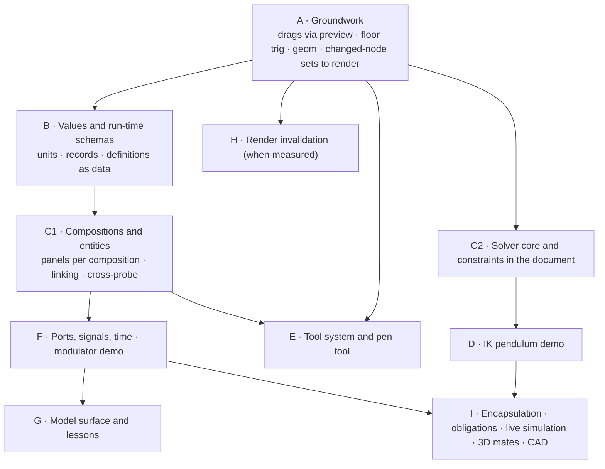

# Roadmap: from the document spine to the intended tool

**Status:** Proposed — living document; update the stage table as work lands
**Date:** 2026-10-09
**Scope:** What a design conversation (2026-10-04 to 10-09) clarified about how Iron is
meant to be used, what that means for the code on branch `document-spine`, and the
order in which to change it. It indexes three companion documents:

- [`vision/09_entities-compositions-and-ports.md`](vision/09_entities-compositions-and-ports.md)
  — the representation model across levels of abstraction (the *why*);
- [`entity-composition-model.md`](entity-composition-model.md) (**ECM** below) — units,
  definitions, entities, ports, signals, compositions, lessons (the *how*);
- [`constraint-system.md`](constraint-system.md) (**CS** below) — constraints,
  interaction-time causality, live simulation.

Ideas discussed but not adopted live in `plans/notes/`; do not build from them until a plan adopts them.

Reconciled on 2026-10-10 against the working tree, where spine steps 6 (clips and the
timeline, `time.rs`) and 7 (the model surface, `src-ui/model/`) are done but not yet
committed. Commit those first, so this work starts from a clean base.

---

## 1. What the conversation clarified

Each item is a decision or a clarified intent, with where it is worked out.

| # | Clarification | Consequence | Where |
|---|---|---|---|
| 1 | `iron_document` is the right foundation: an authored store above Bevy's runtime ECS, as Blender's scene data sits above its depsgraph. Do not fork Bevy | Keep the layering; keep the store thin | §2 |
| 2 | The registry should hold primitives only. Domain things (`bar`, a laser, a fiber) belong in data | Definitions as data; `bar` leaves the registry | ECM §4 |
| 3 | The tool should guide users toward **models plus signal-based inference and visualisation**, with **CAD-style constraints for setting things up** | Two mechanisms with separate jobs: signals and models for physics; constraints for placement | Vision 09 §0, §7–8 |
| 4 | Humans want to grab anything and see what happens, and which side moves is decided at the moment of the grab | Constraints with interaction-time roles; drags through the solver | CS §3, §8 |
| 5 | Common simulation primitives should run in-process at 60 fps, even though doc 02 frames Models as slow call-outs | Floor-tier simulation and model primitives; external Models remain the slow tier | CS §11; vision 09 §7 |
| 6 | Both kinds of path: static ones, and flexible ones that forces act on | Path points as child nodes; one representation for both | CS §13 |
| 7 | **Linking representations across levels of abstraction is central**: a modulator in a schematic, a 3D assembly, and a cartoon | Entity, figure, composition, notation; hub-and-spoke linking | Vision 09 §2–4 |
| 8 | Ports are typed interfaces carrying values with units, structured values, or time series | Units and records early; runtime signals | ECM §3, §6 |
| 9 | A connection carries a signal one way and may imply a constraint (a lens on a beam's rail) | Port kinds declare implied mates | Vision 09 §6; ECM phase 7 |
| 10 | Not every face is a port. Brackets and mate features are local geometry | Ports are semantic; mates stay in their composition; ghost lines stay sparse | Vision 09 §6 |
| 11 | Abstract-to-detailed linking can be under-determined (the bolt) | Derivable, choice, or obligation; strictness deferred | Vision 09 §5; ECM §8 |
| 12 | Annotation is its own layer: it belongs to a lesson and points at the thing | Lessons, steps, annotations with owner and target | Vision 09 §9; ECM §10 |
| 13 | The LLM should hear about causes, not every inferred effect | Notification policy; `.by` markers; obligations as a view | CS §9; ECM §11 |
| 14 | Category theory gives laws, not vocabulary | Six laws become tests | Vision 09 §11 |
| 15 | Users and the LLM can define new notations, as they can build editors | Notations as data | Vision 09 §10 |
| 16 | Rendering should cull before caching; Understory's spatial crates fit the missing middle layer | Pass changed-node sets to rendering; adopt `understory_index` and `understory_box_tree` when measured | §5 |
| 17 | The pen tool and a tool and mouse-context system can start now, independent of caching | Tools as state machines that emit ops and previews | §4 |
| 18 | Drags that only commit on release are fine for undo, but bound and constrained things must respond *during* the drag. Today a drag locks any axis that is bound or clip-driven | All drags go through `preview`; linear bindings invert directly; constrained axes go through the solver instead of locking | §3 stage A |

---

## 2. What stays exactly as it is

These are the spine's strongest decisions, and nothing above weakens them:

- every mutation is an op inside a transaction; inverses are computed at apply time;
  one undo stack;
- stable `NodeId`s, never reused; tombstones; fractional order keys;
- authored versus derived: the file holds only what someone authored; signals,
  resolved bindings, solver previews, and obligations are derived;
- canonical JSON with flat tables;
- the gesture overlay in the store, so manipulation never crosses a process boundary;
- Bevy as a derived consumer, with a `NodeId` ↔ `Entity` map and provenance.

The new concepts are all expressed through these: entities, ports, connections, and
constraints are nodes; links are relations; consistency is computed.

---

## 3. Stages

| Stage | Work | Why now | Exit | Detail |
|---|---|---|---|---|
| **A** Groundwork | Position drags through `Store::preview`, with a post-drag reconcile so nothing lags; `sin cos atan2 sqrt …` in the floor; a `geom` module with world transforms equal to Bevy's; the reconciler's changed-node set passed to rendering instead of one `DocumentDirty` boolean; per-node 2D bounds; **linear binding inversion** (below) | Small, independently useful, and everything later builds on them | A rect bound to another follows it during the drag, not after; dragging a node whose `x = 2·v + 10` sets `v`; render reports which nodes it redrew | CS phase 0 |
| **B** Values and schemas | `Quantity`, `Record`, `Get`; interned field symbols; definitions as data; `bar` becomes a definition | The file format is cheapest to change now, and ports, signals, and definitions all store these | ECM phase 1 exits | ECM §3–4 |
| **C1** Compositions | Model and composition roots, `figures`, one panel per composition, selection by `NodeId`, cross-probing, Show in, Link | The central idea of vision 09, and every later demo needs two or more panels | ECM phase 2 exits | ECM §5, §7 |
| **C2** Constraints | `iron_solve`; constraint nodes; solve-on-apply with `derived_ops` | Independent of B and C1 (pure geometry inside one composition), so it can run in parallel | CS phases 1–2 exits | CS §4–7 |
| **D** IK demo | The pendulum: drag the ball or the platform; a length slider; the LLM notification | The first proof of interaction-time causality, and of telling the LLM causes rather than effects | CS phase 3 exits | CS §14 |
| **E** Tools and pen | Tool state machines; a tool-context resource; a hit-test interface; the pen tool creating paths of point nodes | Asked for soon, mostly independent of caching, and forces the path representation decision early | Draw, close, and edit a path; each click is one transaction; undo per point | §4 |
| **F** Ports and signals | Port kinds, connections, the signal graph; laser → fiber → meter; then time series and the modulator in three compositions | Delivers the "linked representations animate together" goal | ECM phases 3 and 5 exits | ECM §6 |
| **G** Model surface and lessons | Extend the existing model surface (`src-ui/model/`, `document_apply`) with `Model`, `Composition`, and `Lesson` views, the new verbs, solver summaries, and obligations; lessons and annotations | The surface exists and works on the raw tree; it should move to the semantic views as soon as they exist | ECM phase 6 exits | ECM §10–11 |
| **H** Render invalidation | Measure per-panel frame cost; cull with `understory_index`; damage from `understory_box_tree`; dirty presentation with `understory_presentation`; caching only where culling is not enough | Only when measurements say so (doc 07; `bevy-vello-hybrid-design.md` §6) | A local edit redraws only damaged content; frame time with 4 panels is within budget | §5 |
| **I** Later | Encapsulation and obligations (ECM 4); live simulation with grab (CS 5); 3D mates (CS 6); implied constraints and CAD tagging (ECM 7); simulated paths (CS 7) | Each builds on two or more earlier stages | Per document | — |

### Status

| Stage | Status |
|---|---|
| **A** | **Done 2026-10-10** on branch `roadmap`, one commit per item: floor functions and `pi` (`expr.rs`); `geom.rs` with `Store::world_affine`, matched against Bevy by a glam test and a runtime drift check; linear binding inversion (`handle.rs`, `Store::handle`, `Store::preview_target`, `tests/handles.rs`); all position drags through `Store::preview` with `document_bridge::reconcile_gesture` before transform propagation; `DocumentChanges` (the changed-node set plus a structure flag) and `Bounds2d` replace `DocumentDirty`, and the 2D layer logs `redraw (reason): N of M nodes changed [ids]; damage …`. Exit verified in headless Chrome by the run-iron smoke script: the demo's new "shadow" rect (bound to the square) reads the previewed position mid-drag and the screenshot `mid-drag-bound-follows.png` shows it; dragging the bar (`y = 640 − 300·v`) sets the slider in one "move bar" transaction; each drag frame logs the two redrawn nodes and their damage rect. Still re-encodes the whole layer; stage H uses the set to cull |
| **C2** phase 1 | **Done 2026-10-10**: `src/iron_solve`, a dependency-free crate (projected Levenberg–Marquardt with required/strong/weak tiers, clustering, rank analysis naming redundant and conflicting terms). Every CS phase 1 exit test passes natively; the 12-variable benchmark solves in 280 µs native and ≈490 µs in the dev-opt wasm build (`__iron.bench`). Details and deviations in CS §14 phase 1 |
| **C2** phases 2–3 and **D** | **Done 2026-10-11**: constraint nodes, clusters, solve-on-apply with `derived_ops`, `Applied.solver`, `exact`, cycle checks, `.by` markers, the store's drag API (`constraint.rs`, `solve.rs`, `tests/constraints.rs`, golden view); the pendulum demo with every CS phase 3 exit in the smoke script, verified in headless Chrome. Details and deviations in CS §14 phases 2 and 3 |
| **C1** | **Done 2026-10-11** (ECM phase 2), one commit per step, after the `depiction` → `figure` rename (schema 3): root-only `composition` and `model` types (`composition.rs`); one panel per composition (render layers, a camera per 3D panel, per-panel 2D drawing, picking and drags; measured 60 fps at 1, 2 and 4 panels on the GPU, so no fallback); selection by `NodeId` with cross-probe highlights; `Store::link` with the merge question, Show in; `model` and `composition` views with golden files and `<link-figures>` on the model surface. Every phase 2 exit verified by the smoke script. Details and deviations in ECM §12 phase 2 |
| **E** (select tool) | **First part done 2026-10-11**, before the pen tool: Figma's selection, drag and transform semantics (`bevy_app/select.rs`, plans/select-tool.md). Hits carry their chain through groups and embeds; a click selects the outermost node whose container is not open, and top-level embeds act as artboards. The box resizes, rotates and moves through store previews, one transaction per gesture. Also: a marquee, the Esc/Enter/Tab/Cmd+A/arrow/Delete shortcuts, and shell cursors. Undo of a deleted subtree whose nodes bind to each other was fixed in the store. Verified by the smoke script's select-tool section. The pen tool is next |
| **B** | **Done 2026-10-10** (ECM phase 1), one commit per item: registry primitives only (`bar` out); quantities with units (`units.rs`, `Value::Quantity`, dimension-checked floor, quantity literals, file form `{"q": [si, "W"]}`); run-time fields by interning (`sym.rs`, the dynamic `params` component); `Value::Record` and `Expr::Get`; definitions as data (`definition.rs`: `library`/`definition`/`param_spec`/`depiction`/`entity`, `depicts` (since renamed `template` and `figures`, schema 3), validation, instantiation by template copy with reference rewriting). File schema 2, schema 1 still loads. The demo's bar is a definition instantiated into an entity whose `level` is bound to the slider. Decisions taken as the §7 defaults (units) and recorded with deviations in ECM §12 phase 1. Verified natively (`tests/values.rs`, `tests/definitions.rs`) and in the browser by the smoke script |

**The playhead is already shared.** Spine step 6's `time.rs` keeps the playhead in the
store and feeds clip values into the graph's animated layer. Stage F's time-dependent
signals read the same playhead, so a clip and an RF drive stay in step.

**Coordination between B and C2.** Both add registry types (`constraint` in C2;
`definition`, `entity`, and the rest in B and C1). If they run in parallel, land B's
"primitives only" registry change first, so C2 adds `constraint` to the new shape.

### Linear binding inversion (stage A)

Inkling's lesson, applied without a solver: when a dragged leaf is bound to an
expression that is linear in exactly one constant leaf (`x = 2·v + 10`, or
`x = #slider.value * 300`), the drag can set that leaf exactly by inverting the
expression. The gesture previews the source leaf, and the commit writes it. Anything
non-linear, or depending on more than one free leaf, keeps today's snap-back until it
belongs to a constraint cluster. This removes most of the "derived; snapping back"
refusals cheaply, and it is the policy doc 02 §8.2 lists as "edit the underlying
source if the binding is a direct reference", generalised to linear references.

---

## 4. The tool system (stage E)

- **A tool is a state machine** (doc 06 §2: state machines before general handlers).
  States, transitions on pointer and key events, and guards. The pen tool's states:
  idle → placing anchor → dragging handle → (placing anchor | closing) → idle.
- **Tools emit ops and previews only.** They never write Bevy components. Each placed
  anchor is a transaction; the rubber-band segment to the cursor is a preview. Undo
  removes one point.
- **A tool context** resource holds the active tool, modifier state, and the
  composition under the pointer (from the panel map of ECM §7).
- **A hit-test interface** (`hit(panel, point) → Option<NodeId>` and
  `hits_in(panel, rect)`) hides whether hits come from Bevy picking today or the box
  tree later.
- **Paths:** a `path` node with `point` children, each with its own `transform2d`. Point
  handles are leaves on the point, or child nodes if they need their own ids. Every
  point can then be constrained, bound, simulated, and annotated like any other node.
- **Borrow:** Understory's `understory_event_state` (click and drag recognition, hover
  transitions), `understory_selection` (selection with primary and anchor), and
  `understory_precise_hit` (hit-testing filled Béziers) are small, self-contained, and
  fit here directly.

---

## 5. Render invalidation (stage H)

**Four hierarchies, kept separate.** Vision doc 07 §4 already separates authoring groups
from presentation chunks and raster cache entries. Vision 09 adds one more level above
them. From most semantic to most physical:

1. **The model tree**: entities and refinement (what things *are*). Never drawn.
2. **The composition's layout tree**: groups, figures, and local geometry (how a
   diagram is *arranged*). Stable, authored, edited by people and the LLM.
3. **Presentation chunks**: derived, contiguous runs of draw commands grouped by how
   often they change and where they sit (what gets *re-encoded together*).
4. **Raster cache entries**: world-space tiles per zoom level, baked subtree images,
   and temporary gesture proxies (what gets *re-rasterised together*).

Each level can be regrouped without touching the ones above it. Baking a static,
zoomed-out group into an image (`bevy-vello-hybrid-design.md` §6: "grouped ⇒ baked to
atlas; edit mode ⇒ live re-encode; bake aggressively at low zoom") is a decision at
level 4. It never changes the layout tree or the model.

Findings from reading Understory's source (`forest-rs/understory`, August 2026):

- **`understory_box_tree`**: local transform, bounds, clip, and z-order per node;
  `commit()` returns damage rects (the old and new bounds of moved nodes, and the
  bounds of removed ones). This is doc 07 §5.1 almost verbatim.
- **`understory_index`**: a 2D bounds index with flat, grid, R-tree, and BVH backends.
  This is the culling step.
- **`understory_presentation`**: drawing primitives keyed by caller ids, with a
  deduplicated dirty list.
- **None of them emit renderer commands or cache rasters.** They cover levels 2–3's
  bookkeeping (world bounds, damage, culling, dirty primitives), roughly a third of the
  missing middle. Ours to build: forming presentation chunks, encoding them for Vello,
  baking subtree images and tiles per zoom bucket, the atlas allocator (`etagere` or
  `guillotiere`), compositing cached images in Bevy, promotion and demotion policy, and
  memory budgets with eviction (doc 07 §5–8). Their IDs are recycled generational handles, so they need an
  adapter map from `NodeId`, as Understory's own integration guide recommends.
- **The core crates are unpublished** (only `understory_view2d` is on crates.io). Pin a
  git commit or vendor them.
- **The prerequisite is ours:** `sync_document` already computes exactly which nodes
  changed, then collapses that into one boolean, and `render.rs` redraws everything.
  Stage A fixes the plumbing; stage H adds the index and damage, per panel.

One ownership question stays open: world transforms are computed by Bevy for rendering,
by the store for the solver (stage A), and would be computed again by the box tree.
Long term, one of these should be the authority (CS open question I5).

---

## 6. Amendments to existing plans

| Document | Amendment |
|---|---|
| `document-spine.md` §5.10 | A bound or clip-driven axis is locked during a drag, *except* where linear inversion (stage A) or a constraint cluster (CS) gives it a handle |
| `document-spine.md` §5.12 | The model surface gains semantic views and verbs (stage G) |
| `document-spine.md` §15 | `Value::Quantity` is no longer deferred (stage B) |
| `bevy-vello-hybrid-design.md` §6b | Its "keep Bevy ECS as the document model" preference is superseded by the spine; adopting Understory's spatial crates is back on the table (§5) |
| vision 02 §5.3 | "Components" are now "definitions" (vision 09 §3) |
| vision 02 §8.2 | New writeback rows: linear binding → invert; constrained leaf → solve the cluster |
| vision 04 §6 | Views gain `Model`, `Composition`, and `Lesson` relations |
| vision 06 §5 | The units decision is made: SI magnitude plus dimension (ECM §3) |

---

## 7. Decisions needed from you, in the order they block work

1. **Stage B, units:** confirm SI storage with display units as presentation, and that
   geometry stays in pixels and radians (ECM §3, I3).
2. **Stage C1, naming:** entity, definition, depiction, composition, notation. These
   reach the UI soon (vision 09 §13.8). **Decided 2026-10-11:** `depiction` becomes
   **`figure`** (relation `figures`, view attribute `of`); the definition's template child
   becomes `template`; the other four stay. The rename is task 0 in `handoff.md`.
3. **Stage D, model edits under constraints:** adjust and report, or reject by default
   (CS U2).
4. **Stage E, path handles:** leaves on the point, or child nodes with their own ids.
5. **Stage F, conservative ports:** directed signals only, or across and through pairs
   for heat and current (vision 09 §13.2). **Decided 2026-10-12:** both, in one port
   interface: a port kind declares one-way and across/through variables; connections
   compile to dataflow edges and to solver equations; editing from either end goes
   through the gesture solver (ECM §6.1).
6. **Deferred by agreement:** how strictly compositions must stay consistent (vision 09
   §13.1).
