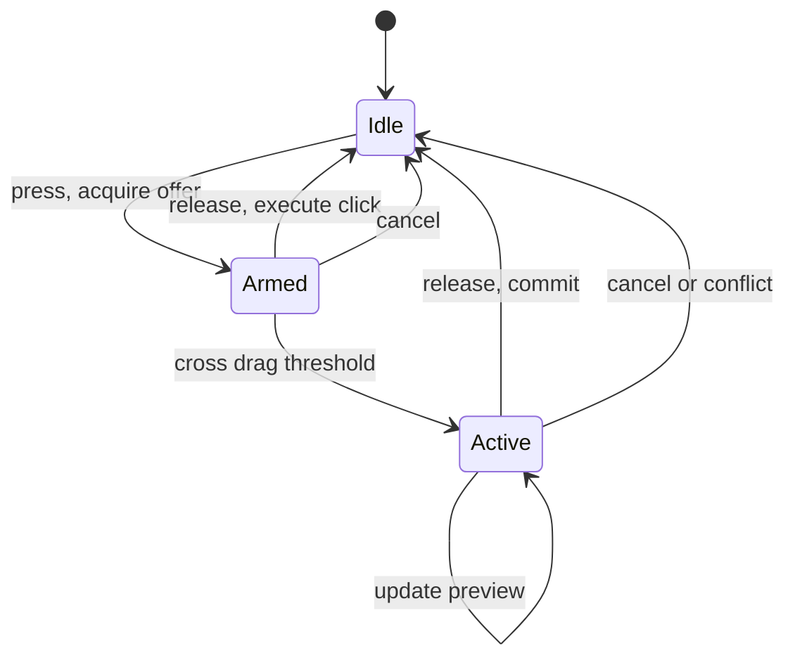

# Interaction lifecycle and shared operation semantics

**Status:** direction agreed with the user, 2026-10-28; implementation plan proposed.
No implementation in this planning pass. The user supports one small interaction
state machine, context-derived behavior beneath it, explicit removal meanings and
shared command paths. Exact public types and warning presentation remain design work.

**Owns:** consolidation of existing interactions and semantic commands. Refines
[`contexts.md`](contexts.md), [`affordances.md`](affordances.md),
[`select-tool.md`](select-tool.md) and the gesture ownership contract in
[`infinite-canvas-architecture-patterns.md`](infinite-canvas-architecture-patterns.md).
The contexts master still owns rule locality and authored policy; the document spine
still owns transactions. Work order lives in [`../handoff-product.md`](../handoff-product.md).
[`authoring-workflows.md`](authoring-workflows.md) explores the creation workflows
that will consume these contracts; its design work need not wait for this refactor.

## 1. Problem and evidence

The store has coherent primitives: transaction ops, handles, preview ownership,
conflict cancellation and runtime producers. Interaction policy is increasingly data,
but execution is spread across special branches in `bevy_app/select.rs`.
`Gesture::Edit(Manip)`, `Gesture::Drive` and `Gesture::Sequence` share lifecycle needs
but implement those needs separately. The select tool also handles clipboard parsing,
removal semantics, component authoring and considerable overlay geometry.

A source-confirmed inconsistency demonstrates the command boundary problem:

- Commit `24c2fe8` taught Delete/Backspace to resolve `affords.delete` and call
  `iron_document::parts::delete_subject_ops` for schematic subjects.
- Cut still copies the selection and queues direct `Op::Delete` for its outermost
  roots. Neither `expand::translate` nor the low-level delete applier supplies the
  missing subject-removal policy afterward.
- `tests/schematic.rs::deleting_a_parts_symbol_deletes_the_part_and_its_wires`
  exercises the helper directly. It does not establish parity between editor routes.

This was traced in source and history, not reproduced in the running app during the
planning discussion. Establish a regression before changing behavior. Atomicity does
not imply semantic parity: two callers can atomically submit different operations.

## 2. Decisions and boundaries

1. Context-dependent interaction is intentional. Authors may make unusual teaching
   controls; built-in behavior remains data, not privileged type-name branches.
2. Contexts choose explicit operation meanings. An operation's implementation computes
   its consequences once for all callers. Raw `Op::Delete` keeps its structural meaning;
   it must not start consulting a host's current selection or context.
3. Distinguish removing a representation from deleting its subject across compositions.
   Contexts are rule definitions, not containers of entity identity: the same subject
   can have representations in compositions with different contexts.
4. Separate authored removal closure from recomputation. Removing an owned child or an
   incident connection is an authored consequence; interpolation, solved poses and
   simulation responses are derived consequences, not automatically additional deletes.
5. Keep one pointer/gesture owner. Every continuous manipulation goes through a common
   lifecycle; geometry and value mappings belong to mechanisms beneath it.
6. Preserve store previews, handle inversion, source bounds, override translation,
   solver fingers and cancellation. Do not introduce a second writeback channel.
7. This work does not introduce arbitrary scripting, a runtime plugin loader, a new
   general lesson state-machine language, or the complete notification system.

## 3. Shared semantic operations

Begin with removal; generalize only where another concrete command needs the contract.
The names below describe responsibilities, not a finalized wire API.

`plan_removal(targets, meaning, scope)` computes a reviewable result without mutation:
resolved subjects, representations, owned nodes and incident connections; proposed ops;
a human/model description; warnings and provenance; and the authored revision the plan
was based on. Prefer recomputation or rejection to executing a stale impact preview.

Meanings must be explicit:

| Meaning | Effect |
|---|---|
| Remove representation | Remove this authored picture/use and its owned drawing content; preserve its entity and other representations |
| Delete subject | Remove the represented entity or connection, its applicable representations and incident connections with their pictures |

Audit ownership, nested instances, definition mains, expanded nodes and other incoming
relations before finalizing the closure. Never infer that every graph dependent should
be deleted. The current `parts` helper is evidence and a starting point, not a complete
general deletion specification. Move shared semantics to an appropriate document-layer
module once their actual ownership is established.

Delete obtains the meaning from the resolved context or an explicit user choice. Cut
uses that same removal plan, plus a clipboard fragment whose closure agrees with what
will be removed. Test connected objects, multiple representations and paste/undo; do
not fix Cut by appending a larger deletion closure without checking its copy semantics.
Model and inspector commands use the same planner with an explicit meaning. Low-level
transaction callers may still intentionally submit structural ops; distinguish that
contract from the high-level user/model command.

For now, show scope and warn when removal affects incident connections or pictures
outside the selected representation. Provide an explicit remove-picture/delete-subject
choice where appropriate. Decide the initial warning UI during phase 0; it must not
silently differ between keyboard, inspector and model routes. Do not add a modal for
every ordinary local deletion. Execution and explanatory warnings derive from the
same planned operation.

## 4. Typed resolution and the registry question

The existing system already has named contexts (`Context.id`), a library, `Field`
indices and validated `Val::Choice` values. Its public `Values::get` returns strings,
which consumers compare or parse again. Author-defined contexts already work; they
compose existing mechanisms. New executable mechanisms still require engine support.

Keep readable serialized names and existing documents. Resolve/compile into typed
consumer values: selection policy, drag kind, activation kind, leaf address, numeric
parameters, tool identifiers and warning/removal meaning. Preserve the source rule
alongside each effective value. Validate compound declarations too: for example, a
ring needs an appropriate driven leaf; an incompatible capability must be explained.

Do not decide on a growable runtime mechanism registry merely to remove string matches.
Start with typed contracts over the current finite vocabulary. Add a registry when it
has concrete consumers for mechanism identity, parameter schema, capability checking
or extension lifecycle. Never persist array positions as document identities. New
contexts and new mechanisms are separate extension operations.

## 5. One interaction coordinator

A press resolves an **interaction offer** from hit geometry, context, selection, focus,
active tool and modifiers. An offer identifies the target occurrence (including its
embed chain), mechanism, coordinate mapping, driven leaves or semantic command,
eligibility/refusal, acquired assumptions and source explanation. Some mappings are
computed at acquisition, not serialized into context markup.

The coordinator has a small common lifecycle:

This is the organizing contract, not a demand that every tool have precisely three
states. Pen/wire multi-click authoring and text/IME retain appropriate internal state;
continuous gestures acquired by them should reuse the lifecycle where applicable.
The common coordinator must not swallow their event ordering or keyboard ownership.

Mechanisms supply begin/update/finish/cancel behavior: move, box transform, drive,
sequence, connection manipulation and related existing mechanisms. Preview values,
fingers and transaction commits remain in `iron_document`. View navigation has an
explicit session-state sink rather than pretending that a pan is a document edit.
Preserve overlay/handle hit priority while extracting it from the coordinator.

Acquire behavior at press and keep it until release. Context/focus changes must not
silently retarget an active gesture. Incompatible changes cancel with a reason; finish
must not commit after cancellation. Specify modifier transitions such as Alt-drag as
intentional behavior within the acquired interaction. Treat the exact transition model
as a phase-1 design decision, including when immediate controls bypass the slop wait.

## 6. Pedagogical explanation and future boundaries

A slider illustrates the existing architecture: pointer motion is mapped to a value,
the value is previewed through a handle, dependents redraw, and release commits one
transaction. A generic ring control does the same with an angle. The current slider
still has a specialized mechanism; it is not evidence that all lesson/context switching
already exists. The generalization is a common interaction contract with data choosing
its use, not a switch that must run for every control.

Preserve explanation facts now: target, driven source, source bounds, locking producer,
source rule and impacted subjects. Future diagnostics may anchor a range restriction
to the representation or input that imposes it in another composition. The full
warning/limitation boundary callout and visual-anchor system is explicitly deferred.
Do not throw away provenance in a way that forces that later system to re-derive it.

Context definitions, component content and application scopes remain separate concepts.
General lesson-stage/time/space activation scopes are investigated in the companion
plan, not implemented opportunistically during the lifecycle cleanup.

## 7. Phases and acceptance

### Phase 0 — shared removal semantics

Inventory current command routes and establish Delete/Cut regression evidence. Define
closure and clipboard semantics, then centralize planning/execution and the initial
scope warning. Cover one representation, several representations of one entity,
incident wires, independent neighbors, undo/redo, stale previews and model commands.
Show a plain-language operation description before claiming the semantics are settled.

### Phase 1 — typed offers and acquisition

Introduce typed resolved behavior incrementally with serialization compatibility and
provenance. Document the press-priority rules and acquired offer for representative
interactions. Confirm click, slop, immediate controls, modifiers and focus transitions.
Extract modules by responsibility without changing gesture semantics incidentally.

### Phase 2 — shared continuous lifecycle

Bring existing move/transform, drive and sequence interactions under the common
lifecycle, preserving specialized geometry. Test release once, cancellation with no
commit, conflicting external edits, bound-source inversion and limits, Alt-drag,
layout preview cleanup, embedded occurrences and 3D manipulation. Include a shared
control driving points on multiple paths (the companion plan's fiber/shadow case):
one acquired gesture, same-frame previews and one commit, with explicit point-offset
editing versus control movement. Preserve both
`sync_document` barriers and web/native input timing.

### Phase 3 — author-facing explanations and consolidation

Expose resolved offers/operation plans to inspection and model reads. Demonstrate the
same authored behavior on a component instance and in two contexts. Audit remaining
branches: geometry specializations may remain; duplicated lifecycle or semantic command
implementations need a reason. Record deferred gaps rather than claiming the whole UI
is now generic.

For behavior implementation, run focused native tests and relevant run-iron fixtures,
then the required full smoke before a behavior commit. Follow the run-iron skill's
expected-output and duration/check-in rules. Record completed work here and in roadmap
Status; this planning pass does not claim those tests or implementation are complete.
